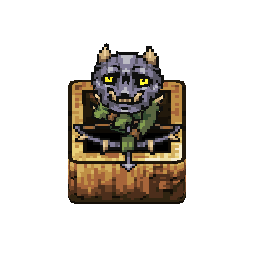
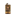

# 座狼弓手（Warg Archer）

[原文与贡献者记录](https://ballxpit.wiki.gg/wiki/Warg_Archer) · [修订 3538](https://ballxpit.wiki.gg/index.php?oldid=3538) · [返回目录](../%E7%90%83%E6%AF%94%E4%BC%A6%E6%88%98%E8%AE%B0%20Wiki.md)

## 信息（Information）

### 类型

[普通敌人](../categories/Normal_enemies.md)

### 生命值倍率（Health scale）

1x

### 等级（Level）

[血腥草原](The_GORYxGRASSLANDS.md) 

**座狼弓手**是出现在 [血腥草原](The_GORYxGRASSLANDS.md)  中的 [普通敌人](../categories/Normal_enemies.md)。其生命值倍率为 1 倍。

它可能与 [座狼](Warg.md)  同时出现。

[共享导航](../navigation/nav-115867ac1be8.md)

**分类**　[分类 · 敌人](../categories/Enemies.md) · [分类 · 普通敌人](../categories/Normal_enemies.md) · [分类 · 带有导航框的页面](../categories/Pages_with_navboxes.md)

[返回总入口](../%E7%90%83%E6%AF%94%E4%BC%A6%E6%88%98%E8%AE%B0%20Wiki.md) · [返回本分目录](%E7%9B%AE%E5%BD%95.md)
