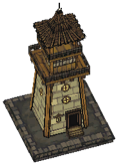

# 守望塔（Watch Tower）

增加收获时钟。

[原文与贡献者记录](https://ballxpit.wiki.gg/wiki/Watch_Tower) · [修订 3340](https://ballxpit.wiki.gg/index.php?oldid=3340) · [返回目录](../%E7%90%83%E6%AF%94%E4%BC%A6%E6%88%98%E8%AE%B0%20Wiki.md)

## 信息（Information）

### 分类（Category）

经济

### 子类（Subcategory）

收获升级

### 蓝图位置（Blueprint location）

[白雪海岸](The_SNOWYxSHORES.md) 

### 基础资源消耗（Base resource cost）

 20  10

### 建造点消耗（Build point cost）

5

**守望塔** 是 *[球比伦战记](Ball_x_Pit.md)* 中的一种收获升级 [建筑物](Buildings.md)。建造守望塔会为初始收获时钟增加时间，通过建筑升级可以增加这一时间量。{?未解机制问题：该时钟增加是否也适用于从 [采集者小屋](Gatherer_s_Hut.md) 开始的对局？}。这一收获时钟可与 [奖励](Harvest_Upgrades_Character_Bonus.md) 叠加：每名拥有  [时间守护者](https://ballxpit.wiki.gg/wiki/Time_Keeper?action=edit&redlink=1) 被动能力的 [角色](Characters.md) 各可叠加一份；拥有  [小麦大师](https://ballxpit.wiki.gg/wiki/Wheat_Master?action=edit&redlink=1)、  [木材大师](https://ballxpit.wiki.gg/wiki/Wood_Master?action=edit&redlink=1) 或  [石之大师](https://ballxpit.wiki.gg/wiki/Stone_Master?action=edit&redlink=1) 被动能力的角色可从有效弹跳中获得额外时间；此外，当 [自笞者](The_Flagellant.md)  解锁相应能力后， [修道院](Monastery.md) 也会提供额外时间。

被动效果与升级

| 等级 | 图片 | 说明 | 资源消耗 | 建造点消耗 | 拆除 |
| --- | --- | --- | --- | --- | --- |
| 1 |  | 将收获时钟增加2秒。 |  20  10 | 5 |  20  10 |
| 2 |  | 将收获时钟增加 3 秒。 |  50  40 | 5 |  70  50 |
| 3 |  | 将收获时钟增加4秒。 |  75  60 | 15 |  145  110 |

[共享导航](../navigation/nav-d4956b01aa56.md)

**分类**　[分类 · 建筑](../categories/Buildings.md) · [分类 · 经济](../categories/Economy.md) · [分类 · 收获升级](../categories/Harvest_Upgrades.md) · [分类 · 带有导航框的页面](../categories/Pages_with_navboxes.md)

[返回总入口](../%E7%90%83%E6%AF%94%E4%BC%A6%E6%88%98%E8%AE%B0%20Wiki.md) · [返回本分目录](%E7%9B%AE%E5%BD%95.md)
