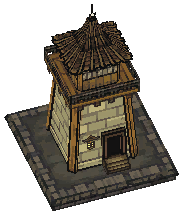
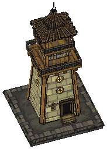

# 卫报（Watch Tower）

增加收获时间。

[原文与贡献者记录](https://ballxpit.wiki.gg/wiki/Watch_Tower) · [修订 3340](https://ballxpit.wiki.gg/index.php?oldid=3340) · [返回目录](../%E7%90%83%E6%AF%94%E4%BC%A6%E6%88%98%E8%AE%B0%20Wiki.md)

#### 信息（Information）

##### 分类（Category）

经济

##### 子类（Subcategory）

收获升级

##### 蓝图位置（Blueprint location）

[白雪海岸](The_SNOWYxSHORES.md) 

##### 基础资源消耗（Base resource cost）

 20  10

##### 建造点消耗（Build point cost）

5

其他 **卫报** 是一个收获升级 [建筑物](Buildings.md) 在 *[球比伦战记](Ball_x_Pit.md)*。 建造守望塔为最初的收成时钟增加时间，其数量可以通过建筑物升级而增加。 {?不使用MECHINC 问题:这一时钟的增加是否也适用于从 [收藏家的小屋](Gatherer_s_Hut.md)收成时钟增加堆叠 [奖金奖金](Harvest_Upgrades_Character_Bonus.md) 从每份 [性格](Characters.md) 在  [时间守护者](https://ballxpit.wiki.gg/wiki/Time_Keeper?action=edit&redlink=1) 适用时给予的被动能力以及奖金时间与  [麦子主](https://ballxpit.wiki.gg/wiki/Wheat_Master?action=edit&redlink=1)、  [木材师](https://ballxpit.wiki.gg/wiki/Wood_Master?action=edit&redlink=1),或  [石头师](https://ballxpit.wiki.gg/wiki/Stone_Master?action=edit&redlink=1) 或从 [修道院](Monastery.md) 一次 [自笞者](The_Flagellant.md)  已经解锁了能力。

被动效果与升级

| 等级 | 图片 | 描述 | 资源消耗 | 建造点消耗 | 拆除 |
| --- | --- | --- | --- | --- | --- |
| 1 |  | 收成时钟加长2秒 |  20  10 | 5 |  20  10 |
| 2 |  | 收成时钟加长3秒 |  50  40 | 5 |  70  50 |
| 3 |  | 收成时钟加长4秒 |  75  60 | 15 |  145  110 |

[共享导航](../navigation/nav-d4956b01aa56.md)

**分类**　[分类 · 建筑](../categories/Buildings.md) · [分类 · 经济](../categories/Economy.md) · [分类 · 收获升级](../categories/Harvest_Upgrades.md) · [分类 · 页面有导航框](../categories/Pages_with_navboxes.md)

[返回总入口](../%E7%90%83%E6%AF%94%E4%BC%A6%E6%88%98%E8%AE%B0%20Wiki.md) · [返回本分目录](%E7%9B%AE%E5%BD%95.md)
