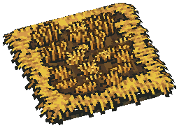
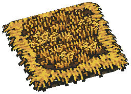
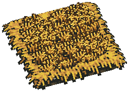

# 麦田（Wheat Field）

一个收获的田野  麦子。

[原文与贡献者记录](https://ballxpit.wiki.gg/wiki/Wheat_Field) · [修订 3329](https://ballxpit.wiki.gg/index.php?oldid=3329) · [返回目录](../%E7%90%83%E6%AF%94%E4%BC%A6%E6%88%98%E8%AE%B0%20Wiki.md)

#### 信息（Information）

##### 分类（Category）

经济

##### 子类（Subcategory）

资源

##### 蓝图位置（Blueprint location）

- (默认解锁)

##### 基础资源消耗（Base resource cost）

 30

##### 建造点消耗（Build point cost）

0 (立即)

其他 **麦田** 是一个资源 [建筑物](Buildings.md) 在 *[球比伦战记](Ball_x_Pit.md)* 并且是最初的2x2变体  游戏开始时可用的小麦资源牌。 此牌增长  1在设定的间隔内，直到击中设定的最大容量为止，两者都可以通过建设升级来改进，但总是从  1在建时。除收割模式下的反弹或来自 [收藏家的小屋](Gatherer_s_Hut.md),这种瓷砖也可以被动地从 [农场](Farm.md) 或是 [单身家庭](Single_Family_Home.md) 一次 [空巢者](The_Empty_Nester.md)  与大多数建筑物不同，资源和收集子类别中的这类和其他建筑物可以建造多次，只要玩家有必要的资源和空间。

默认情况下， 此瓷砖不导致工人在收获时反弹。 字符可以选择  [麦机](https://ballxpit.wiki.gg/wiki/Wheat_Harvester?action=edit&redlink=1) 或是  [麦子主](https://ballxpit.wiki.gg/wiki/Wheat_Master?action=edit&redlink=1) [升级](Harvest_Upgrades_Character_Bonus.md) 增加小麦的收割量，或每次他们从这个瓷砖中收割时分别增加剩余的收割时钟。 [别墅](Villa.md) 一次 [沉思者](The_Cogitator.md)  已经解锁了能力。

一旦打开 [密集的小麦](Dense_Wheat.md) , 小麦场就可以在功能上被取代。

被动效果与升级

| 等级 | 图片 | 描述 | 资源消耗 | 建造点消耗 | 拆除 | 创建资源 | 复兴率 | 产能 |
| --- | --- | --- | --- | --- | --- | --- | --- | --- |
| 1 |  | 一个收获的田野  麦子。 |  30 | 0 (立即) |  30 |  小麦 | 5分钟/  1 |  1 |
| 2 |  | 一个收获的田野  麦子。 |  120 | 0 (立即) |  150 |  小麦 | 4分钟 /  1 |  4 |
| 3 |  | 一个收获的田野  麦子。 |  180 | 0 (立即) |  330 |  小麦 | 3分钟  1 |  7 |

[共享导航](../navigation/nav-d4956b01aa56.md)

**分类**　[分类 · 建筑](../categories/Buildings.md) · [分类 · 经济](../categories/Economy.md) · [分类 · 资源](../categories/Resources.md) · [分类 · 页面有导航框](../categories/Pages_with_navboxes.md)

[返回总入口](../%E7%90%83%E6%AF%94%E4%BC%A6%E6%88%98%E8%AE%B0%20Wiki.md) · [返回本分目录](%E7%9B%AE%E5%BD%95.md)
