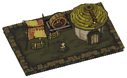
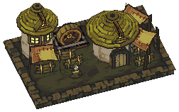
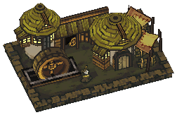
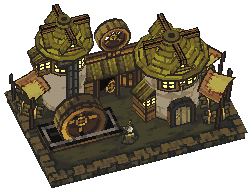
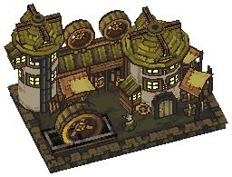

# 车轮匠（Wheelwright）

提高速度的属性系数等级。

[原文与贡献者记录](https://ballxpit.wiki.gg/wiki/Wheelwright) · [修订 3358](https://ballxpit.wiki.gg/index.php?oldid=3358) · [返回目录](../%E7%90%83%E6%AF%94%E4%BC%A6%E6%88%98%E8%AE%B0%20Wiki.md)

## 信息（Information）

### 分类（Category）

战争

### 子类（Subcategory）

属性成长

### 蓝图位置（Blueprint location）

[SNOWYxSHORES](The_SNOWYxSHORES.md)

### 基础资源消耗（Base resource cost）

 150  20  5

### 建造点消耗（Build point cost）

8

车轮匠是六座提高属性系数的建筑之一，可提高所有角色的速度系数等级。建成后从基础 E 级提升到 D 级，升级最高可达 S 级。系数等级越高，每点速度给相关能力带来的加成越大。建筑升至 5 级可解锁「S 级」（S Rank）成就。

被动效果与升级

| 等级 | 图片 | 说明 | 资源消耗 | 建造点消耗 | 拆除 |
| --- | --- | --- | --- | --- | --- |
| 1 |  | 将速度的属性系数提升至 D 级。随着速度提高，移动速度等相关数值获得的改善也会更大。 |  150  20  5 | 8 |  150  20  5 |
| 2 |  | 将速度的属性系数提升至 C 级。随着速度提高，移动速度等相关数值获得的改善也会更大。 |  200  25  5 | 8 |  350  45  10 |
| 3 |  | 将速度的属性系数提升至 B 级。随着速度提高，移动速度等相关数值获得的改善也会更大。 |  400  50  10 | 24 |  750  95  20 |
| 4 |  | 将速度的属性系数提升至 A 级。随着速度提高，移动速度等相关数值获得的改善也会更大。 |  1,000  125  25 | 40 |  1,750  220  45 |
| 5 |  | 将速度的属性系数提升至 S 级。随着速度提高，移动速度等相关数值获得的改善也会更大。 |  2,000  250  50 | 56 |  3,750  470  95 |

[共享导航](../navigation/nav-d4956b01aa56.md)

**分类**　[分类 · 建筑](../categories/Buildings.md) · [分类 · 战争](../categories/Warfare.md) · [分类 · 属性成长](../categories/Stat_Scaling.md) · [分类 · 带有导航框的页面](../categories/Pages_with_navboxes.md)

[返回总入口](../%E7%90%83%E6%AF%94%E4%BC%A6%E6%88%98%E8%AE%B0%20Wiki.md) · [返回本分目录](%E7%9B%AE%E5%BD%95.md)
