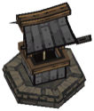
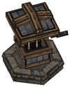

# 许愿池（Wishing Well）

升级时会增加获得额外升级点的几率。

[原文与贡献者记录](https://ballxpit.wiki.gg/wiki/Wishing_Well) · [修订 3381](https://ballxpit.wiki.gg/index.php?oldid=3381) · [返回目录](../%E7%90%83%E6%AF%94%E4%BC%A6%E6%88%98%E8%AE%B0%20Wiki.md)

## 信息（Information）

### 分类（Category）

战争

### 子类（Subcategory）

将军

### 蓝图位置（Blueprint location）

[SMOLDERINGxDEPTHS](The_SMOLDERINGxDEPTHS.md)

### 基础资源消耗（Base resource cost）

 1,000  60

### 建造点消耗（Build point cost）

5

在升级过程中，建造许愿池会增加获得额外升级点的概率，通过建筑升级可以进一步提高这一概率。

被动效果与升级

| 等级 | 图片 | 说明 | 资源消耗 | 建造点消耗 | 拆除 |
| --- | --- | --- | --- | --- | --- |
| 1 |  | 升级时，有 4% 的概率额外获得一个升级点。 |  1,000  60 | 5 |  1,000  60 |
| 2 |  | 升级时，有 5% 的概率获得额外的升级点。 |  2,000  120 | 5 |  3,000  180 |
| 3 |  | 升级时，有 6% 的概率额外获得一个升级点。 |  3,000  180 | 15 |  6,000  360 |

[共享导航](../navigation/nav-d4956b01aa56.md)

**分类**　[分类 · 建筑](../categories/Buildings.md) · [分类 · 战争](../categories/Warfare.md) · [分类 · 通用](../categories/General.md) · [分类 · 带有导航框的页面](../categories/Pages_with_navboxes.md)

[返回总入口](../%E7%90%83%E6%AF%94%E4%BC%A6%E6%88%98%E8%AE%B0%20Wiki.md) · [返回本分目录](%E7%9B%AE%E5%BD%95.md)
