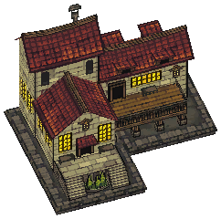
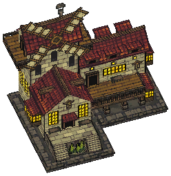

# 工人协会 (建筑)（Worker's Guild (Building)）

[原文与贡献者记录](https://ballxpit.wiki.gg/wiki/Worker%27s_Guild_%28Building%29) · [修订 2610](https://ballxpit.wiki.gg/index.php?oldid=2610) · [返回目录](../%E7%90%83%E6%AF%94%E4%BC%A6%E6%88%98%E8%AE%B0%20Wiki.md)

不应与 [工人公会（升级 / Achievement）](https://ballxpit.wiki.gg/wiki/Worker%27s_Guild_%28Achievement%29?action=edit&redlink=1).

#### 工人协会（Worker's Guild）

让工人在游戏结束时收集24小时的资源价值，但速度较慢。

#### 信息（Information）

##### 分类（Category）

经济

##### 子类（Subcategory）

多种类型

##### 蓝图位置（Blueprint location）

[天堂之门](The_HEAVENLYxGATES.md) 

##### 基础资源消耗（Base resource cost）

 5,000

##### 建造点消耗（Build point cost）

100

其他 **工人协会** 是一个多元经济 [建筑物](Buildings.md) 在 *[球比伦战记](Ball_x_Pit.md)*建立工人公会允许建筑(包括: [性格](Characters.md) [住房](Buildings.md#%E4%BD%8F%E6%88%BF%E5%BB%BA%E7%AD%91%E4%B8%80%E8%A7%88) 在 [释放的被动收获能力](Character_Level_Mechanics.md)以一次性总付的方式发放所收集的资源，下次玩家打开保存空位时，该玩家将再次打开保存空位。然而，以这种方式收集的资源以较低的速度收获(可通过建筑物升级加以改进)，在授标之前可按这种方式收集的资源总量以24小时为上限。首次建造这栋建筑使工人协会取得了成就

被动效果与升级

| 等级 | 图片 | 描述 | 资源消耗 | 建造点消耗 | 拆除 |
| --- | --- | --- | --- | --- | --- |
| 1 |  | 让工人在游戏结束时收集24小时的资源价值。 资源以这种方式收集的速度慢了50%。 |  5,000 | 100 |  5,000 |
| 2 |  | 让工人在游戏结束时收集24小时的资源价值。 以这种方式，资源收集速度要慢40% 。 |  7,500 | 100 |  12,500 |
| 3 |  | 让工人在游戏结束时聚集24小时的资源价值。 以这种方式，资源收集速度要慢30%。 |  11,250 | 300 |  23,750 |

**分类**　[分类 · 建筑](../categories/Buildings.md) · [分类 · 经济](../categories/Economy.md) · [分类 · 多种类型](../categories/Miscellaneous.md)

[返回总入口](../%E7%90%83%E6%AF%94%E4%BC%A6%E6%88%98%E8%AE%B0%20Wiki.md) · [返回本分目录](%E7%9B%AE%E5%BD%95.md)
