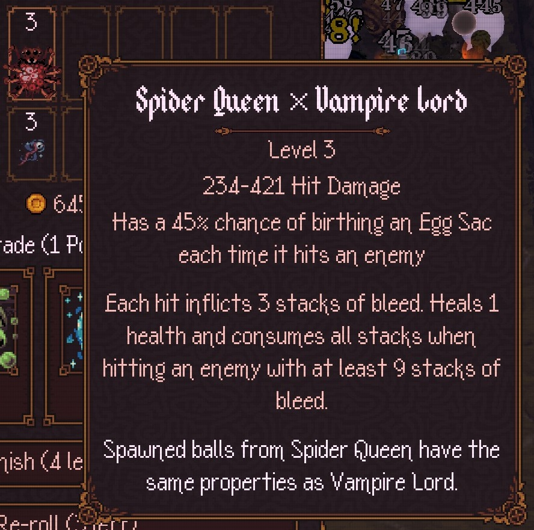

# Fusion Example Spider Queen x Vampire Lord.jpg

[本地原文件](../assets/Fusion_Example_Spider_Queen_x_Vampire_Lord.jpg) · [文件说明与署名](https://ballxpit.wiki.gg/wiki/File:Fusion_Example_Spider_Queen_x_Vampire_Lord.jpg) · [修订 2371](https://ballxpit.wiki.gg/index.php?oldid=2371)

image/jpeg · 888 × 881 · 269,306 字节

用于展示融合圆球排列差异的示例截图。

**源页许可标记**　`{{License|game}}`

**分类**　[分类 · 截图](../categories/Screenshots.md)

[返回总入口](../%E7%90%83%E6%AF%94%E4%BC%A6%E6%88%98%E8%AE%B0%20Wiki.md) · [返回本分目录](%E7%9B%AE%E5%BD%95.md)
