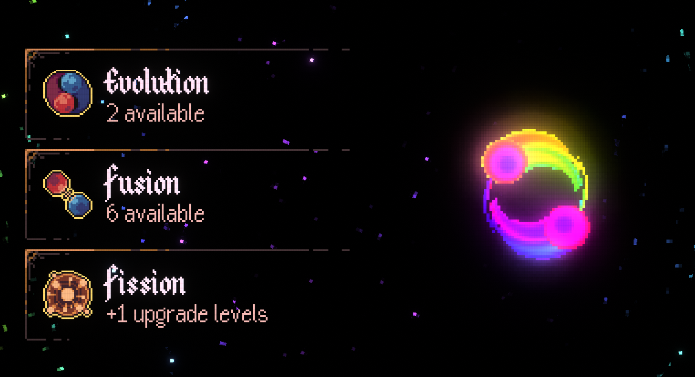

# Fusion Reactor Options.png

[本地原文件](../assets/Fusion_Reactor_Options.png) · [文件说明与署名](https://ballxpit.wiki.gg/wiki/File:Fusion_Reactor_Options.png) · [修订 384](https://ballxpit.wiki.gg/index.php?oldid=384)

image/png · 1143 × 620 · 557,012 字节

融合反应堆选项

[返回总入口](../%E7%90%83%E6%AF%94%E4%BC%A6%E6%88%98%E8%AE%B0%20Wiki.md) · [返回本分目录](%E7%9B%AE%E5%BD%95.md)
