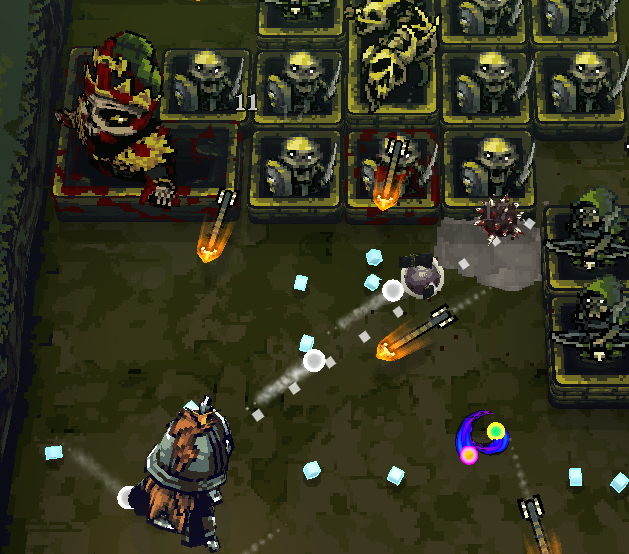

# The Warrior attacking.png

[本地原文件](../assets/The_Warrior_attacking.png) · [文件说明与署名](https://ballxpit.wiki.gg/wiki/File:The_Warrior_attacking.png) · [修订 1940](https://ballxpit.wiki.gg/index.php?oldid=1940)

image/png · 629 × 554 · 201,244 字节

总结
《球比伦战记》游戏百科截图：战士在骸骨墓园中攻击一些敌人。

**源页许可标记**　`{{License|game}}`

[返回总入口](../%E7%90%83%E6%AF%94%E4%BC%A6%E6%88%98%E8%AE%B0%20Wiki.md) · [返回本分目录](%E7%9B%AE%E5%BD%95.md)
