# 共享导航

[查看或编辑此模板](../templates/Enemies.md)

敌人

[骸骨墓园](../articles/The_BONExYARD.md) 

* [骨架战士](../articles/Skeleton_Warrior.md) 
* [骸骨蛮兵](../articles/Skeletal_Brute.md) 
* [骸骨野兽](../articles/Skeletal_Beast.md) 
* [骸骨主教](../articles/Skeletal_Bishop.md) 
* [骸骨堡垒](../articles/Skeletal_Bastion.md) 
* [骨架弓箭手](../articles/Skeleton_Archer.md) 
* [骨贝赫莫特](../articles/Bone_Behemoth.md) 
* [骨架旅队](../articles/Skeletal_Brigade.md) 
* [骨球ista](../articles/Bone_Ballista.md) [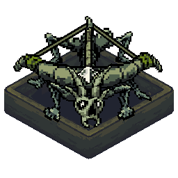](../articles/Bone_Ballista.md)
* [骨架国王](../articles/Skeleton_King.md) 

[白雪海岸](../articles/The_SNOWYxSHORES.md) 

* [冰岛战士](../articles/Icebound_Warrior.md) [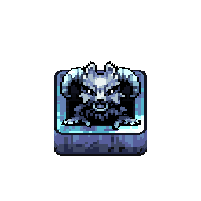](../articles/Icebound_Warrior.md)
* [冰伤残疾](../articles/Icebound_Brute.md) [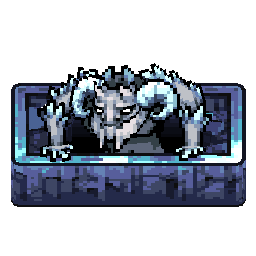](../articles/Icebound_Brute.md)
* [冰封野兽](../articles/Icebound_Beast.md) 
* [冰封指环](../articles/Icebound_Band.md) 
* [冰岛堡垒](../articles/Icebound_Bastion.md) 
* [冰患盾牌手](../articles/Icebound_Shieldbearer.md) 
* [冰封投掷者](../articles/Icebound_Hurler.md) 
* [冰球冠军](../articles/Icebound_Champion.md) 
* [冰封嚎兽](../articles/Icebound_Howler.md) 
* [冰岛女王](../articles/Icebound_Queen.md) 

[边境沙漠](../articles/The_LIMINALxDESERT.md) 

* [蜥蜴](../articles/Lizard.md) 
* [蛮力蜥蜴](../articles/Lizard_Brute.md) 
* [滑蜥](../articles/Slizard.md) 
* [蜥蜴壮汉](../articles/Lizard_Strongman.md) 
* [蜥蜴堡垒](../articles/Lizard_Bastion.md) 
* [激光蝗虫](../articles/Laser_Locust.md) 
* [蠕虫](../articles/Worm.md) 
* [沙步行者](../articles/Sandwalker.md) 
* [转移的科布拉](../articles/Shifting_Cobra.md) 
* [沙漠哨兵](../articles/Desert_Sentinel.md) [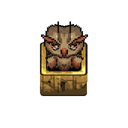](../articles/Desert_Sentinel.md)
* [狂怒蝗虫](../articles/Seething_Locust.md) 
* [伟大的卫兵](../articles/Great_Sentinel.md) 
* [扭曲的蛇](../articles/Twisted_Serpent.md) 

[真菌森林](../articles/The_FUNGALxFOREST.md) 

* [蘑菇战士](../articles/Shroom_Fighter.md) [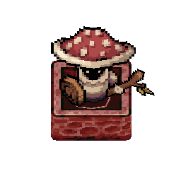](../articles/Shroom_Fighter.md)
* [双生蘑菇](../articles/Twin_Shrooms.md) [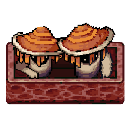](../articles/Twin_Shrooms.md)
* [潜行菇](../articles/Shroom_Stalker.md) [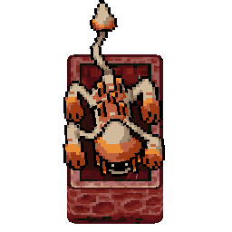](../articles/Shroom_Stalker.md)
* [层架菌](../articles/Bracket_Fungus.md) 
* [伊诺基集团](../articles/Enoki_Cluster.md) [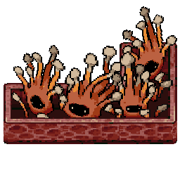](../articles/Enoki_Cluster.md)
* [爆炸菇](../articles/Boomshroom.md) 
* [螺旋式螺旋桨](../articles/Cordyceps_Spitter.md) [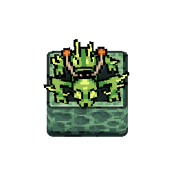](../articles/Cordyceps_Spitter.md)
* [工作室](../articles/Rushroom.md) 
* [爆鸣菇](../articles/Shroomboomer.md) 
* [科尔迪西普斯女王](../articles/Cordyceps_Queen.md) 
* [长老爆炸菇](../articles/Elder_Boomshroom.md) 
* [菇群](../articles/Shroom_Swarm.md) 

[血腥草原](../articles/The_GORYxGRASSLANDS.md) 

* [华格](../articles/Warg.md) [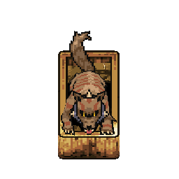](../articles/Warg.md)
* [沃格骑手](../articles/Warg_Rider.md) 
* [沃格·阿彻](../articles/Warg_Archer.md) 
* [鼠标](../articles/Mouse.md) [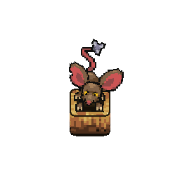](../articles/Mouse.md)
* [古代的华格](../articles/Ancient_Warg.md) 
* [妖精战主](../articles/Goblin_Warlord.md) 
* [妖精狙击手](../articles/Goblin_Sniper.md) 
* [沙伯牙](../articles/Sabertooth.md) 

[阴燃深渊](../articles/The_SMOLDERINGxDEPTHS.md) 

* [幼龙](../articles/Dragonling.md) [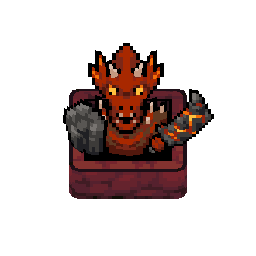](../articles/Dragonling.md)
* [龙头野兽](../articles/Dragonling_Brute.md) [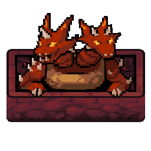](../articles/Dragonling_Brute.md)
* [龙号号号](../articles/Dragonling_Thrall.md) 
* [龙头屠夫](../articles/Dragonling_Butcher.md) 
* [龙子族](../articles/Dragonling_Clan.md) 
* [集群群](../articles/Grub_Cluster.md) 
* [幼虫](../articles/Grub.md) 
* [消防员](../articles/Firespitter.md) 
* [幼虫母体](../articles/Grub_Mother.md) 
* [Great Grub 群集群集](../articles/Great_Grub_Cluster.md) 
* [喷焰者](../articles/Flamespitter.md) 
* [龙王子](../articles/Dragon_Prince.md) 

[天堂之门](../articles/The_HEAVENLYxGATES.md) 

* [天使眷属](../articles/Angelspawn.md) 
* [天使双头](../articles/Angelic_Twinhead.md) 
* [天使巨鸮](../articles/Angelic_Great_Owl.md) 
* [Angelspawn 贝尔塞尔](../articles/Angelspawn_Berserker.md) 
* [天使队合唱团](../articles/Angelspawn_Choir.md) [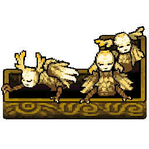](../articles/Angelspawn_Choir.md)
* [双翼天使](../articles/Winged_Angelspawn.md) 
* [双翼天使童子军](../articles/Winged_Angelspawn_Scout.md) 
* [Angelspawh 女祭司](../articles/Angelspawn_Priestess.md) 
* [Angelspawn Snatcher 天使捕猎者](../articles/Angelspawn_Snatcher.md) 
* [丘比特](../articles/Cupid.md) 
* [一个不安的人](../articles/Restless_One.md) [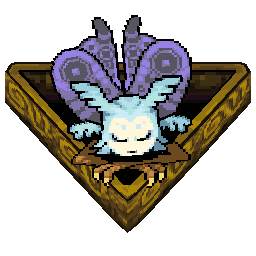](../articles/Restless_One.md)
* [枯瘦劫掠者](../articles/Wizened_Snatcher.md) 
* [猫头鹰领主](../articles/Lord_of_Owls.md) 

[浩瀚虚空](../articles/The_VASTxVOID.md) 

* [月灵](../articles/Moonling.md) [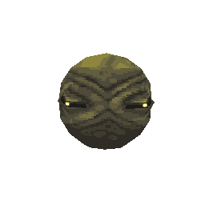](../articles/Moonling.md)
* [月球弓箭手](../articles/Moonling_Archer.md) 
* [月亮的地质](../articles/Moonling_Geode.md) 
* [月石](../articles/Moonrock.md) 
* [废除](../articles/Voidling.md) 
* [半月月亮](../articles/Crescent_Moonling.md) 
* [衰落的月球](../articles/Waning_Moonling.md) 
* [月族](../articles/Moonkin.md) 
* [月族晶洞](../articles/Moonkin_Geode.md) [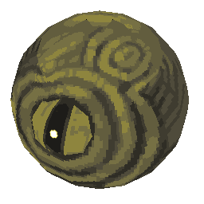](../articles/Moonkin_Geode.md)
* [月亮](../articles/The_Moon.md) 

[返回总入口](../%E7%90%83%E6%AF%94%E4%BC%A6%E6%88%98%E8%AE%B0%20Wiki.md) · [返回本分目录](%E7%9B%AE%E5%BD%95.md)
