# 共享导航

[查看或编辑此模板](../templates/Passives.md)

被动道具

[基本被动](../articles/Passives.md#%E5%9F%BA%E6%9C%AC%E8%A2%AB%E5%8A%A8)

* [弓箭手雕像](../articles/Archer_s_Effigy.md) 
* [人工心脏](../articles/Artificial_Heart.md) [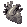](../articles/Artificial_Heart.md)
* [婴儿摇铃](../articles/Baby_Rattle.md) 
* [绷带卷](../articles/Bandage_Roll.md) [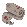](../articles/Bandage_Roll.md)
* [瓶装龙卷风](../articles/Bottled_Tornado.md) [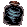](../articles/Bottled_Tornado.md)
* [胸罩](../articles/Breastplate.md) 
* [棘的冠冕](../articles/Crown_of_Thorns.md) 
* [诅咒的精液](../articles/Cursed_Elixir.md) [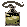](../articles/Cursed_Elixir.md)
* [死亡眼睛的宝藏](../articles/Deadeye_s_Amulet.md) 
* [钻石钻头](../articles/Diamond_Hilted_Dagger.md) 
* [动力石](../articles/Dynamite.md) [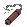](../articles/Dynamite.md)
* [翡翠光光闪闪](../articles/Emerald_Hilted_Dagger.md) 
* [虚灵斗篷](../articles/Ethereal_Cloak.md) [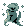](../articles/Ethereal_Cloak.md)
* [一直流动的杯子](../articles/Everflowing_Goblet.md) 
* [观察者的眼睛](../articles/Eye_of_the_Beholder.md) 
* [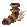](https://ballxpit.wiki.gg/wiki/Fleet_Feet) [舰队脚](https://ballxpit.wiki.gg/wiki/Fleet_Feet?action=edit&redlink=1)
* [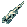](https://ballxpit.wiki.gg/wiki/Frozen_Spike) [冰冻尖刺](https://ballxpit.wiki.gg/wiki/Frozen_Spike?action=edit&redlink=1)
* [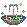](https://ballxpit.wiki.gg/wiki/Gemspring) [宝石之春](https://ballxpit.wiki.gg/wiki/Gemspring?action=edit&redlink=1)
* [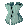](https://ballxpit.wiki.gg/wiki/Ghostly_Corset) [幽灵的皮套](https://ballxpit.wiki.gg/wiki/Ghostly_Corset?action=edit&redlink=1)
*  [幽灵盾牌](https://ballxpit.wiki.gg/wiki/Ghostly_Shield?action=edit&redlink=1)
*  [黄金牛](https://ballxpit.wiki.gg/wiki/Golden_Bull?action=edit&redlink=1)
*  [手机风扇](https://ballxpit.wiki.gg/wiki/Hand_Fan?action=edit&redlink=1)
*  [手镜](https://ballxpit.wiki.gg/wiki/Hand_Mirror?action=edit&redlink=1)
*  [医生的效果](https://ballxpit.wiki.gg/wiki/Healer%27s_Effigy?action=edit&redlink=1)
* [砂钟](../articles/Hourglass.md) 
* [铁制连体衣](../articles/Iron_Onesie.md) [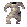](../articles/Iron_Onesie.md)
*  [死亡的吻](https://ballxpit.wiki.gg/wiki/Kiss_of_Death?action=edit&redlink=1)
*  [恋人的箭袋](https://ballxpit.wiki.gg/wiki/Lover%27s_Quiver?action=edit&redlink=1)
* [魔术人员](../articles/Magic_Staff.md) [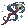](../articles/Magic_Staff.md)
* [磁铁](../articles/Magnet.md) 
* [午夜油](../articles/Midnight_Oil.md) [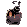](../articles/Midnight_Oil.md)
* [哑铃](../articles/Platinum_Dumbbell.md) [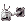](../articles/Platinum_Dumbbell.md)
* [压力阀](../articles/Pressure_Valve.md) 
* [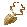](https://ballxpit.wiki.gg/wiki/Protective_Charm) [保护的魅力](https://ballxpit.wiki.gg/wiki/Protective_Charm?action=edit&redlink=1)
* [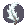](https://ballxpit.wiki.gg/wiki/Radiant_Feather) [发光的羽毛](https://ballxpit.wiki.gg/wiki/Radiant_Feather?action=edit&redlink=1)
* [射手的矛](../articles/Reacher_s_Spear.md) 
*  [橡胶头带](https://ballxpit.wiki.gg/wiki/Rubber_Headband?action=edit&redlink=1)
* [Ruby 闪亮的弹跳器](../articles/Ruby_Hilted_Dagger.md) 
* [Sapphire 欢笑大算器](../articles/Sapphire_Hilted_Dagger.md) [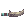](../articles/Sapphire_Hilted_Dagger.md)
* [短弓](../articles/Shortbow.md) [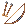](../articles/Shortbow.md)
* [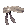](https://ballxpit.wiki.gg/wiki/Silver_Blindfold) [银眼罩](https://ballxpit.wiki.gg/wiki/Silver_Blindfold?action=edit&redlink=1)
* [银子子弹](../articles/Silver_Bullet.md) [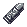](../articles/Silver_Bullet.md)
* [弹弓](../articles/Slingshot.md) [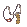](../articles/Slingshot.md)
*  [尖刺项圈](https://ballxpit.wiki.gg/wiki/Spiked_Collar?action=edit&redlink=1)
* [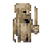](https://ballxpit.wiki.gg/wiki/Stone_Effigy) [石雕像](https://ballxpit.wiki.gg/wiki/Stone_Effigy?action=edit&redlink=1)
* [剑打破者](../articles/Sword_Breaker.md) [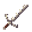](../articles/Sword_Breaker.md)
* [叛徒的外套](../articles/Traitor_s_Cowl.md) 
* [塔楼](../articles/Turret.md) [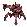](../articles/Turret.md)
* [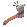](https://ballxpit.wiki.gg/wiki/Upturned_Hatchet) [翻转的斧头](https://ballxpit.wiki.gg/wiki/Upturned_Hatchet?action=edit&redlink=1)
* [吸血鬼剑](../articles/Vampiric_Sword.md) [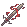](../articles/Vampiric_Sword.md)
* [伏都娃娃](../articles/Voodoo_Doll.md) [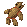](../articles/Voodoo_Doll.md)
*  [车轮](https://ballxpit.wiki.gg/wiki/Wagon_Wheel?action=edit&redlink=1)
* [战争角](../articles/War_Horn.md) [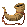](../articles/War_Horn.md)
*  [可怜洋葱](https://ballxpit.wiki.gg/wiki/Wretched_Onion?action=edit&redlink=1)

[进化被动](../articles/Passives.md#%E8%BF%9B%E5%8C%96%E8%A2%AB%E5%8A%A8)

* [燃烧的轮胎](../articles/Ardent_Tire.md) [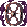](../articles/Ardent_Tire.md)
* [阿根廷止时钟](../articles/Argent_Stopwatch.md) [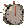](../articles/Argent_Stopwatch.md)
* [命运的箭](../articles/Arrow_of_Fate.md) [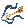](../articles/Arrow_of_Fate.md)
* [黄斑](../articles/Cornucopia.md) [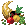](../articles/Cornucopia.md)
* ["死眼之十字架"](../articles/Deadeye_s_Cross.md) 
* [死眼的硬化剂](../articles/Deadeye_s_Impaler.md) 
* [全金属光谱机](../articles/Full_Metal_Rapier.md) [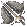](../articles/Full_Metal_Rapier.md)
* [慈悲不仁者](../articles/Gracious_Impaler.md) [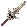](../articles/Gracious_Impaler.md)
* [怪异的炮兵](../articles/Grotesque_Artillery.md) [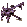](../articles/Grotesque_Artillery.md)
* [光荣锤](../articles/Inglorious_Hammer.md) [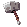](../articles/Inglorious_Hammer.md)
* [恶臭外壳](../articles/Odiferous_Shell.md) [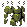](../articles/Odiferous_Shell.md)
* [鬼魂雷加利亚](../articles/Phantom_Regalia.md) [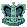](../articles/Phantom_Regalia.md)
* [远程发射器](../articles/Remote_Detonator.md) [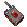](../articles/Remote_Detonator.md)
* [灵魂收获者](../articles/Soul_Reaver.md) [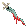](../articles/Soul_Reaver.md)
* [折磨者面具](../articles/Tormenters_Mask.md) [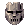](../articles/Tormenters_Mask.md)
* [风织机](../articles/Windweaver.md) 
* [油膏者的翅膀](../articles/Wings_of_the_Anointed.md) [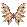](../articles/Wings_of_the_Anointed.md)

[返回总入口](../%E7%90%83%E6%AF%94%E4%BC%A6%E6%88%98%E8%AE%B0%20Wiki.md) · [返回本分目录](%E7%9B%AE%E5%BD%95.md)
