# 共享导航

[查看或编辑此模板](../templates/Buildings.md)

建筑

经济

资源

* [麦田](../articles/Wheat_Field.md) [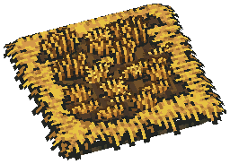](../articles/Wheat_Field.md)
* [密集的小麦](../articles/Dense_Wheat.md) 
* [森林](../articles/Forest.md) [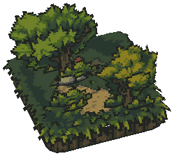](../articles/Forest.md)
* [大树](../articles/Grand_Tree.md) [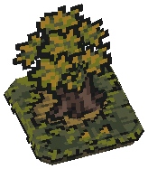](../articles/Grand_Tree.md)
* [石头](../articles/Boulder.md) [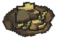](../articles/Boulder.md)
* [花岗岩板](../articles/Granite_Slab.md) [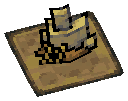](../articles/Granite_Slab.md)

聚会

* [农场](../articles/Farm.md) 
* [木工场](../articles/Lumberyard.md) 
* [石矿](../articles/Stone_Mine.md) [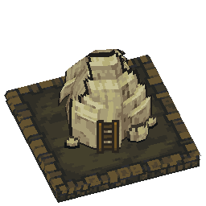](../articles/Stone_Mine.md)
* [金矿](../articles/Gold_Mine.md) 
* [收藏家的小屋](../articles/Gatherer_s_Hut.md) 

收获升级

* [卫报](../articles/Watch_Tower.md) 
* [道路守护者](../articles/Road_Keeper.md) [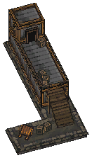](../articles/Road_Keeper.md)

多种类型

* [市场](../articles/Market.md) 
* [工人协会](../articles/Worker_s_Guild_Building.md) 
* [热水池](../articles/Spa.md) [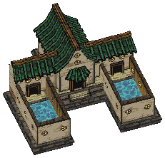](../articles/Spa.md)
* [协会厅](../articles/Guild_Hall.md) 

战争

属性加成

* [领事馆](../articles/Consulate.md) 
* [校园](../articles/Schoolhouse.md) 
* [鞋匠](../articles/Shoemaker.md) [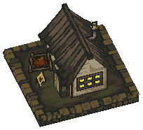](../articles/Shoemaker.md)
* [枪手](../articles/Gunsmith.md) 
* [兵营](../articles/Barracks.md) 
* [诊所](../articles/Clinic.md) [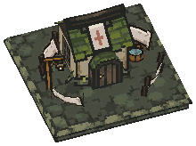](../articles/Clinic.md)

无穷无尽的升级建筑物

* [医院](../articles/Hospital.md) 
* [战士协会](../articles/Warrior_s_Guild.md) 
* [资本中心](../articles/Capitolium.md) 
* [车车工厂](../articles/Wagon_Factory.md) [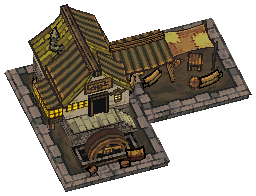](../articles/Wagon_Factory.md)
* [射手协会](../articles/Marksman_s_Guild.md) 
* [大博物馆](../articles/Grand_Museum.md) 

统计规模

* [车手](../articles/Wheelwright.md) 
* [军事学院](../articles/Military_Academy.md) 
* [化学家](../articles/Alchemist.md) 
* [大学](../articles/University.md) [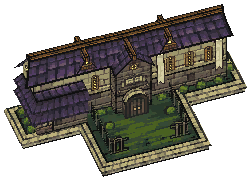](../articles/University.md)
* [射箭射击范围](../articles/Archery_Range.md) [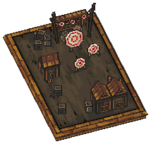](../articles/Archery_Range.md)
* [外交厅](../articles/Diplomacy_Hall.md) 

通关奖励

* [骸骨墓园奖杯](../articles/Boneyard_Trophy.md) 
* [雪杯](../articles/Snowy_Trophy.md) 
* [沙漠奖杯](../articles/Desert_Trophy.md) [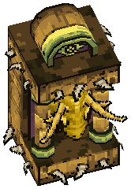](../articles/Desert_Trophy.md)
* [蘑菇奖杯](../articles/Shroom_Trophy.md) 
* [戈里奖杯](../articles/Gory_Trophy.md) [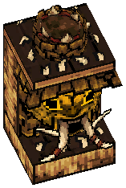](../articles/Gory_Trophy.md)
* [生动的奖杯](../articles/Smoldering_Trophy.md) [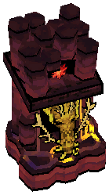](../articles/Smoldering_Trophy.md)
* [天上的奖杯](../articles/Heavenly_Trophy.md) [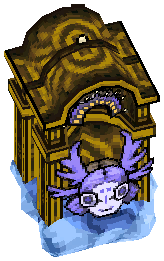](../articles/Heavenly_Trophy.md)
* [虚空奖杯](../articles/Void_Trophy.md) 

总

* [修道院](../articles/Abbey.md) 
* [珠宝家](../articles/Jeweler.md) 
* [死灵法师](../articles/Necromancer.md) [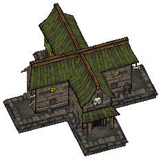](../articles/Necromancer.md)
* [银行](../articles/Bank.md) 
* [匹配机](../articles/Matchmaker.md) 
* [磁铁工厂](../articles/Magnet_Factory.md) [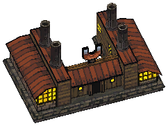](../articles/Magnet_Factory.md)
* [蜡烛作坊](../articles/Candle_Maker.md) 
* [赌徒巢穴](../articles/Gambler_s_Den.md) 
* [赌场](../articles/Casino.md) 
* [愿意好好](../articles/Wishing_Well.md) 
* [进化室](../articles/Evolution_Chamber_Building.md) 
* [遗物收藏家](../articles/Relic_Collector_Building.md) 
* [冥想帐篷](../articles/Meditation_Tent.md) [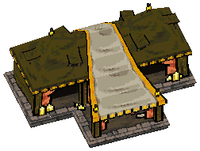](../articles/Meditation_Tent.md)
* [驱魔者](../articles/Exorcist.md) 
* [石家庄](../articles/Gemsmith.md) 
* [古董店](../articles/Antique_Shop.md) 
* [战争室](../articles/War_Room.md) 
* [包装机器](../articles/Bag_Maker_Building.md) 
* [木匠](../articles/Carpenter_Building.md) 
* [冒险家协会](../articles/Adventurer_s_Guild.md) 

住房

* [警长办公室](../articles/Sheriff_s_Office.md) 
* [鬼鬼之家](../articles/Haunted_House.md) 
* [剧院](../articles/Theater.md) 
* [舒适的家](../articles/Cozy_Home.md) [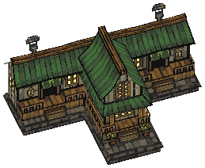](../articles/Cozy_Home.md)
* [别墅](../articles/Villa.md) 
* [陵墓](../articles/Mausoleum.md) 
* [铁堡垒](../articles/Iron_Fortress.md) 
* [队长的四处](../articles/Captain_s_Quarters.md) 
* [露营场](../articles/Campground.md) [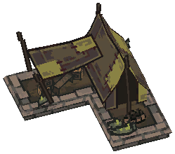](../articles/Campground.md)
* [单身家庭](../articles/Single_Family_Home.md) [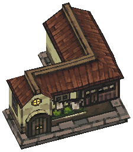](../articles/Single_Family_Home.md)
* [洛基山](../articles/Rocky_Hill.md) 
* [修道院](../articles/Monastery.md) 
* [实验室](../articles/Laboratory.md) 
* [退伍军人小屋](../articles/Veteran_s_Hut.md) 
* [豪宅](../articles/Mansion.md) 
* [驯鹰小屋](../articles/Falconry_Hut.md) 
* [聚会之家](../articles/Party_House.md) 
* [石域](../articles/Stone_Domain.md) 
* [隐秘神殿](../articles/Hidden_Temple.md) [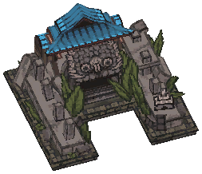](../articles/Hidden_Temple.md)
* [球场](../articles/Ball_House.md) 
* [不稳定的塔楼](../articles/Unstable_Tower.md) 

[返回总入口](../%E7%90%83%E6%AF%94%E4%BC%A6%E6%88%98%E8%AE%B0%20Wiki.md) · [返回本分目录](%E7%9B%AE%E5%BD%95.md)
