# 共享导航

[查看或编辑此模板](../templates/Buildings.md)

建筑

经济

资源

* [小麦田](../articles/Wheat_Field.md) [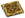](../articles/Wheat_Field.md)
* [密集小麦](../articles/Dense_Wheat.md) 
* [森林](../articles/Forest.md) 
* [大树](../articles/Grand_Tree.md) 
* [巨石](../articles/Boulder.md) [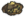](../articles/Boulder.md)
* [花岗岩板](../articles/Granite_Slab.md) 

收集

* [农场](../articles/Farm.md) [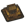](../articles/Farm.md)
* [伐木场](../articles/Lumberyard.md) [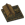](../articles/Lumberyard.md)
* [石矿场](../articles/Stone_Mine.md) 
* [金矿](../articles/Gold_Mine.md) 
* [采集者小屋](../articles/Gatherer_s_Hut.md) [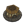](../articles/Gatherer_s_Hut.md)

收获升级

* [守望塔](../articles/Watch_Tower.md) 
* [道路守护者](../articles/Road_Keeper.md) 

其他信息

* [市场](../articles/Market.md) 
* [工人工会](../articles/Worker_s_Guild_Building.md) 
* [温泉浴场](../articles/Spa.md) 
* [公会大厅](../articles/Guild_Hall.md) [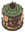](../articles/Guild_Hall.md)

战争

属性加成

* [领事馆](../articles/Consulate.md) 
* [学堂](../articles/Schoolhouse.md) [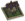](../articles/Schoolhouse.md)
* [鞋匠](../articles/Shoemaker.md) 
* [枪匠](../articles/Gunsmith.md) 
* [兵营](../articles/Barracks.md) 
* [诊所](../articles/Clinic.md) 

可无限升级的建筑

* [医院](../articles/Hospital.md) 
* [战士公会](../articles/Warrior_s_Guild.md) [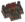](../articles/Warrior_s_Guild.md)
* [议事殿](../articles/Capitolium.md) 
* [马车工厂](../articles/Wagon_Factory.md) 
* [射手公会](../articles/Marksman_s_Guild.md) [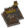](../articles/Marksman_s_Guild.md)
* [大博物馆](../articles/Grand_Museum.md) 

属性成长

* [车轮匠](../articles/Wheelwright.md) 
* [军事学院](../articles/Military_Academy.md) 
* [炼金术士](../articles/Alchemist.md) 
* [大学](../articles/University.md) 
* [射箭场](../articles/Archery_Range.md) [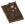](../articles/Archery_Range.md)
* [外交厅](../articles/Diplomacy_Hall.md) 

通关奖励

* [骸骨墓园奖杯](../articles/Boneyard_Trophy.md) [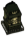](../articles/Boneyard_Trophy.md)
* [白雪海岸奖杯](../articles/Snowy_Trophy.md) 
* [沙漠奖杯](../articles/Desert_Trophy.md) 
* [蘑菇奖杯](../articles/Shroom_Trophy.md) 
* [血腥草原奖杯](../articles/Gory_Trophy.md) 
* [阴燃深渊奖杯](../articles/Smoldering_Trophy.md) [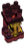](../articles/Smoldering_Trophy.md)
* [天堂之门奖杯](../articles/Heavenly_Trophy.md) 
* [虚空奖杯](../articles/Void_Trophy.md) 

通用

* [修道院](../articles/Abbey.md) 
* [珠宝匠](../articles/Jeweler.md) [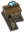](../articles/Jeweler.md)
* [死灵法师](../articles/Necromancer.md) 
* [银行](../articles/Bank.md) 
* [匹配机](../articles/Matchmaker.md) 
* [磁铁工厂](../articles/Magnet_Factory.md) [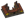](../articles/Magnet_Factory.md)
* [蜡烛作坊](../articles/Candle_Maker.md) [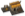](../articles/Candle_Maker.md)
* [赌徒巢穴](../articles/Gambler_s_Den.md) 
* [赌场](../articles/Casino.md) 
* [许愿池](../articles/Wishing_Well.md) [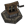](../articles/Wishing_Well.md)
* [进化室](../articles/Evolution_Chamber_Building.md) [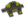](../articles/Evolution_Chamber_Building.md)
* [遗迹收集者](../articles/Relic_Collector_Building.md) 
* [冥想帐篷](../articles/Meditation_Tent.md) 
* [驱魔人](../articles/Exorcist.md) 
* [宝石匠](../articles/Gemsmith.md) 
* [古董店](../articles/Antique_Shop.md) [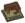](../articles/Antique_Shop.md)
* [作战室](../articles/War_Room.md) 
* [包制师](../articles/Bag_Maker_Building.md) [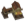](../articles/Bag_Maker_Building.md)
* [木匠](../articles/Carpenter_Building.md) [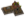](../articles/Carpenter_Building.md)
* [冒险者公会](../articles/Adventurer_s_Guild.md) [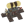](../articles/Adventurer_s_Guild.md)

住房

* [警长办公室](../articles/Sheriff_s_Office.md) 
* [鬼屋](../articles/Haunted_House.md) 
* [剧场](../articles/Theater.md) 
* [舒适的家](../articles/Cozy_Home.md) 
* [别墅](../articles/Villa.md) 
* [陵墓](../articles/Mausoleum.md) 
* [铁堡](../articles/Iron_Fortress.md) [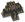](../articles/Iron_Fortress.md)
* [队长宿舍](../articles/Captain_s_Quarters.md) 
* [露营地](../articles/Campground.md) 
* [独栋住宅](../articles/Single_Family_Home.md) 
* [岩石山丘](../articles/Rocky_Hill.md) 
* [修道院](../articles/Monastery.md) 
* [实验室](../articles/Laboratory.md) [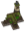](../articles/Laboratory.md)
* [老兵小屋](../articles/Veteran_s_Hut.md) [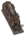](../articles/Veteran_s_Hut.md)
* [豪宅](../articles/Mansion.md) 
* [驯鹰小屋](../articles/Falconry_Hut.md) 
* [派对之家](../articles/Party_House.md) 
* [石之领域](../articles/Stone_Domain.md) 
* [隐秘神殿](../articles/Hidden_Temple.md) 
* [圆球屋](../articles/Ball_House.md) 
* [不稳定塔](../articles/Unstable_Tower.md) [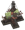](../articles/Unstable_Tower.md)

[返回总入口](../%E7%90%83%E6%AF%94%E4%BC%A6%E6%88%98%E8%AE%B0%20Wiki.md) · [返回本分目录](%E7%9B%AE%E5%BD%95.md)
