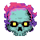
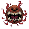
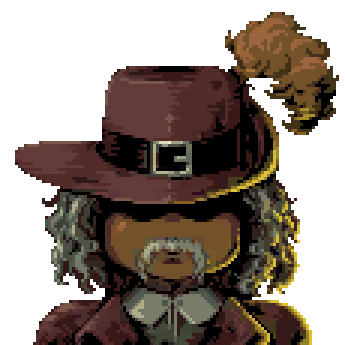

# 模板 · 圆球（Ball）

[原文与贡献者记录](https://ballxpit.wiki.gg/wiki/Template:Ball) · [修订 3214](https://ballxpit.wiki.gg/index.php?oldid=3214) · [返回目录](../%E7%90%83%E6%AF%94%E4%BC%A6%E6%88%98%E8%AE%B0%20Wiki.md)

| 模板文档 |
| --- |
| *注:未提供值，模板样本的某些部分可能无法见。* |
| 查看或编辑 [此文档](Ball_doc.md) ( [关于模板文档](Documentation.md)) |
| 编辑器可以在此模板 [sandbox](https://ballxpit.wiki.gg/wiki/Template:Ball/sandbox?action=edit) 和 [测试案例](https://ballxpit.wiki.gg/wiki/Template:Ball/testcases) 页面上进行实验。 |

#### 描述

要使用此模板， 请添加 {} {}圆球模板并填入相应字段。 左空字段不会出现在文章中。 此信息框模板的使用 [方制信息箱语法](https://ballxpit.wiki.gg/wiki/W%3AHelp%3AInfobox?action=edit&redlink=1).

#### 语法

```
{{Character
 | description  =
 | character1   =
 | character2   =
 | unlocking    =
 | damagetype   =
 | status       =
 | evoball1     =
 | evoball2     =
 | evoball3     =
 | evoball4     =
 | evoball5     =
 | evoball6     =
 | evoball7     =
}}
```

#### 抽样产出

#### 流血（Bleed）

[](../files/Bleed.png.md)

2堆血，流血的敌人在被球击中时每堆1个损伤(最大8个堆)。

#### 一般信息

##### 角色（Characters）

[战士](../articles/The_Warrior.md) [](../articles/The_Warrior.md)
[伪救世主](../articles/The_False_Messiah.md) [](../articles/The_False_Messiah.md)

##### 解锁

N/A (在比赛开始时可用)

##### 损失类型

敌军德布夫

##### 状态效果（Status Effects）

出血

##### 发展情况（Evolutions）

[贝尔塞克](../articles/Berserk.md) [](../articles/Berserk.md)
[输血](../articles/Hemorrhage.md) [](../articles/Hemorrhage.md)
[李克](../articles/Leech.md) [](../articles/Leech.md)
[牺牲](../articles/Sacrifice.md) [](../articles/Sacrifice.md)
[吸血鬼主](../articles/Vampire_Lord.md) [](../articles/Vampire_Lord.md)

#### 灼烧（Burn）

[](../files/Burn.png.md)

应用刻录( 4-8 dmg/ s) 。 最大 3 Stacks

#### 一般信息

##### 性格（Character）

[快枪手](../articles/The_Itchy_Finger.md) [](../articles/The_Itchy_Finger.md)

##### 解锁

N/A (在比赛开始时可用)

##### 损失类型

中弹， 长期伤害伤害

##### 状态效果（Status Effects）

燃烧燃烧

##### 发展情况（Evolutions）

[驱逐的火焰](../articles/Banished_Flame.md) [](../articles/Banished_Flame.md)
[贝尔塞克](../articles/Berserk.md) [](../articles/Berserk.md)
[炸弹](../articles/Bomb.md) [](../articles/Bomb.md)
[硫磺](../articles/Brimstone.md) [](../articles/Brimstone.md)
[烟花](../articles/Fireworks.md) [](../articles/Fireworks.md)
[冰冻火焰](../articles/Frozen_Flame.md) [](../articles/Frozen_Flame.md)
[在地狱里](../articles/Inferno.md) [](../articles/Inferno.md)
[马格玛](../articles/Magma.md) [](../articles/Magma.md)
[太阳](../articles/Sun.md) [](../articles/Sun.md)

```
{{Ball
 | name         = Bleed
 | image        = Bleed.png
 | description  = Inflicts 2 stacks of bleed. Bleeding enemies receive 1 damage per stack when hit by a ball (max 8 stacks).
 | character1   = The Warrior
 | character2   = The False Messiah
 | unlocking    = N/A (available at the start of the game)
 | damagetype   = On Hit, Enemy Debuff
 | status       = Bleeding
 | evoball1     = Berserk
 | evoball2     = Hemorrhage
 | evoball3     = Leech
 | evoball4     = Sacrifice
 | evoball5     = Vampire Lord
}}
{{Ball
 | name         = Fire
 | image        = Fire.png
 | description  = Applies burn (4-8 dmg/s). Max 3 Stacks
 | character1   = The Itchy Finger
 | unlocking    = N/A (available at the start of the game)
 | damagetype   = On Hit, Damage Over Time
 | status       = Burning
 | evoball1     = Banished Flame
 | evoball2     = Berserk
 | evoball3     = Bomb
 | evoball4     = Brimstone
 | evoball5     = Fireworks
 | evoball6     = Frozen Flame
 | evoball7     = Inferno
 | evoball8     = Magma
 | evoball9     = Sun
}}
```

**注:** 名称和图像参数是完全可选的，将分别默认于页名和图像名称。

**分类**　[分类 · 信息框模板](../categories/Infobox_templates.md)

[返回总入口](../%E7%90%83%E6%AF%94%E4%BC%A6%E6%88%98%E8%AE%B0%20Wiki.md) · [返回本分目录](%E7%9B%AE%E5%BD%95.md)
