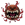

# 模板 · 圆球（Ball）

[原文与贡献者记录](https://ballxpit.wiki.gg/wiki/Template:Ball) · [修订 3214](https://ballxpit.wiki.gg/index.php?oldid=3214) · [返回目录](../%E7%90%83%E6%AF%94%E4%BC%A6%E6%88%98%E8%AE%B0%20Wiki.md)

| 模板文档 |
| --- |
| *注意：如果没有提供数值，模板样本的部分内容可能无法显示。* |
| 查看或编辑 [此文档](Ball_doc.md)。（[关于模板文档](Documentation.md)） |
| 编辑可以在此模板的[沙盒](https://ballxpit.wiki.gg/wiki/Template:Ball/sandbox?action=edit)和[测试案例](https://ballxpit.wiki.gg/wiki/Template:Ball/testcases)页面上进行实验。 |

## 说明

要使用此模板，请添加 {{圆球}} 模板并填写相应的字段。未填写的字段将不会出现在文章中。此信息框模板使用 [Fandom 的信息框语法](https://ballxpit.wiki.gg/wiki/W%3AHelp%3AInfobox?action=edit&redlink=1)。

## 语法

```
{{Character
 | description  =
 | character1   =
 | character2   =
 | unlocking    =
 | damagetype   =
 | status       =
 | evoball1     =
 | evoball2     =
 | evoball3     =
 | evoball4     =
 | evoball5     =
 | evoball6     =
 | evoball7     =
}}
```

## 示例输出

## 流血（Bleed）

[](../files/Bleed.png.md)

施加2层流血效果。被球击中的敌人每层会遭受1点伤害（最多8层）。

## 基本信息

### 角色（Characters）

[战士](../articles/The_Warrior.md) [](../articles/The_Warrior.md)
[伪救世主](../articles/The_False_Messiah.md) [](../articles/The_False_Messiah.md)

### 解锁

N/A（游戏开始时可获取）

### 伤害类型

命中时，敌人减益

### 状态效果（Status Effects）

流血

### 进化（Evolutions）

[狂暴](../articles/Berserk.md) [](../articles/Berserk.md)
[大出血](../articles/Hemorrhage.md) [](../articles/Hemorrhage.md)
[水蛭](../articles/Leech.md) [](../articles/Leech.md)
[献祭](../articles/Sacrifice.md) [](../articles/Sacrifice.md)
[吸血鬼领主](../articles/Vampire_Lord.md) [](../articles/Vampire_Lord.md)

## 灼烧（Burn）

[](../files/Burn.png.md)

施加灼烧效果（4-8点伤害/秒）。最多可叠加3层。

## 基本信息

### 角色（Character）

[快枪手](../articles/The_Itchy_Finger.md) [](../articles/The_Itchy_Finger.md)

### 解锁

N/A（游戏开始时可获取）

### 伤害类型

命中时，随时间伤害

### 状态效果（Status Effects）

燃烧

### 进化（Evolutions）

[放逐之焰](../articles/Banished_Flame.md) [](../articles/Banished_Flame.md)
[狂暴](../articles/Berserk.md) [](../articles/Berserk.md)
[炸弹](../articles/Bomb.md) [](../articles/Bomb.md)
[硫磺](../articles/Brimstone.md) [](../articles/Brimstone.md)
[烟花](../articles/Fireworks.md) [](../articles/Fireworks.md)
[冰冻火焰](../articles/Frozen_Flame.md) [](../articles/Frozen_Flame.md)
[炼狱](../articles/Inferno.md) [](../articles/Inferno.md)
[岩浆](../articles/Magma.md) [](../articles/Magma.md)
[太阳](../articles/Sun.md) [](../articles/Sun.md)

```
{{Ball
 | name         = Bleed
 | image        = Bleed.png
 | description  = Inflicts 2 stacks of bleed. Bleeding enemies receive 1 damage per stack when hit by a ball (max 8 stacks).
 | character1   = The Warrior
 | character2   = The False Messiah
 | unlocking    = N/A (available at the start of the game)
 | damagetype   = On Hit, Enemy Debuff
 | status       = Bleeding
 | evoball1     = Berserk
 | evoball2     = Hemorrhage
 | evoball3     = Leech
 | evoball4     = Sacrifice
 | evoball5     = Vampire Lord
}}
{{Ball
 | name         = Fire
 | image        = Fire.png
 | description  = Applies burn (4-8 dmg/s). Max 3 Stacks
 | character1   = The Itchy Finger
 | unlocking    = N/A (available at the start of the game)
 | damagetype   = On Hit, Damage Over Time
 | status       = Burning
 | evoball1     = Banished Flame
 | evoball2     = Berserk
 | evoball3     = Bomb
 | evoball4     = Brimstone
 | evoball5     = Fireworks
 | evoball6     = Frozen Flame
 | evoball7     = Inferno
 | evoball8     = Magma
 | evoball9     = Sun
}}
```

**注意：** 名称和图片参数完全是可选的，将分别默认为页面名称和图片名称。

**分类**　[分类 · 信息框模板](../categories/Infobox_templates.md)

[返回总入口](../%E7%90%83%E6%AF%94%E4%BC%A6%E6%88%98%E8%AE%B0%20Wiki.md) · [返回本分目录](%E7%9B%AE%E5%BD%95.md)
