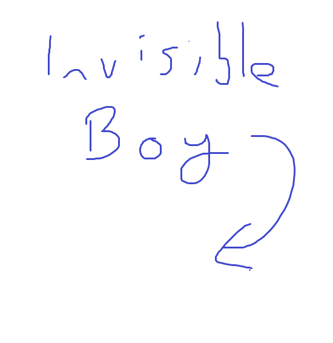

# 模板 · 角色图标（Character icon）

[原文与贡献者记录](https://ballxpit.wiki.gg/wiki/Template:Character_icon) · [修订 482](https://ballxpit.wiki.gg/index.php?oldid=482) · [返回目录](../%E7%90%83%E6%AF%94%E4%BC%A6%E6%88%98%E8%AE%B0%20Wiki.md)

| 模板文档 |
| --- |
| *注意：如果没有提供数值，模板样本的部分内容可能无法显示。* |
| 查看或编辑 [此文档](Character_icon_doc.md)。（[关于模板文档](Documentation.md)） |
| 编辑可以在此模板的[沙盒](https://ballxpit.wiki.gg/wiki/Template:Character_icon/sandbox?action=edit)和[测试案例](https://ballxpit.wiki.gg/wiki/Template:Character_icon/testcases)页面上进行实验。 |

## 总结

使用此模板在页面链接旁显示图标。该模板假设每个页面的图标都上传在特定的位置，即“File:Page Name （Character）.png”。

模板参数 此模板更倾向于使用内联格式设置参数。

| 参数 |  | 说明 | 类型 | 状态 |
| --- | --- | --- | --- | --- |
| 页面名称 | `1` `page` | 目标页面的名称。 示例页面名称 | 页面名称 | 必需 |
| 链接标签 | `2` `label` | 该文本将显示在链接图标的标签上。 示例替代页面名称 | 线 | 可选 |

## 示例

对于以下示例， `File:Invisible Boy (Character).png` 被用作名为“Page Called”的页面的图标。 `Invisible Boy`.

| 代码 | 结果 |
| --- | --- |
| `{{Character icon\|Invisible Boy}}` |  [隐形男孩](https://ballxpit.wiki.gg/wiki/Invisible_Boy?action=edit&redlink=1) |
| `{{Character icon\|Invisible Boy\|The Invisible Boy}}` |  [隐形男孩](https://ballxpit.wiki.gg/wiki/Invisible_Boy?action=edit&redlink=1) |
| `{{Character icon\|Invisible Boy\|notext}}` |  |
| `{{Character icon\|Missing Boy}}` （缺失页面图标 / Missing Page Icon） | [?](https://ballxpit.wiki.gg/wiki/Special:Upload?wpDestFile=Missing_Boy_%28Character%29.png) [失踪男孩](https://ballxpit.wiki.gg/wiki/Missing_Boy?action=edit&redlink=1) |

## 依赖项

为了让此模板正常工作，您需要以下内容：

* 基础 `{{[Link icon](Link_icon.md)}}` 模板。
* `.link-icon` 类及其相关类，位于 [MediaWiki:Common.css](../site/MediaWiki_Common.css.md).

**分类**　[分类 · 文件链接失效的页面](../categories/Pages_with_broken_file_links.md) · [分类 · 模板格式化](../categories/Formatting_templates.md)

[返回总入口](../%E7%90%83%E6%AF%94%E4%BC%A6%E6%88%98%E8%AE%B0%20Wiki.md) · [返回本分目录](%E7%9B%AE%E5%BD%95.md)
