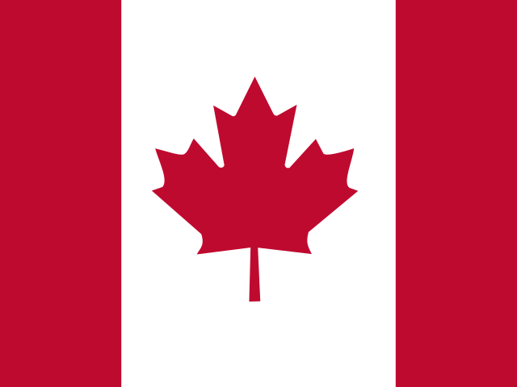

# 模板 · 标志/文件（Flag/doc）

[原文与贡献者记录](https://ballxpit.wiki.gg/wiki/Template:Flag%2Fdoc) · [修订 498](https://ballxpit.wiki.gg/index.php?oldid=498) · [返回目录](../%E7%90%83%E6%AF%94%E4%BC%A6%E6%88%98%E8%AE%B0%20Wiki.md)

此格式化模板允许您在内部显示国家国旗。

可用国旗可见于 [我们的公域维基维基](https://commons.wiki.gg/wiki/Category%3ACountry_flags)。

#### 使用率

该模板可用以下格式格式使用: `{{flag|code|Legend}}`,其中::

* `code` 是 [ISO 3166-1 α-2标准](https://en.wikipedia.org/wiki/ISO_3166-1_alpha-2) 国旗代码。
* `Legend` 是悬浮(可选择的)上显示的图例。

#### 实例实例实例

| 《法典法典法典》 | 结果 |
| --- | --- |
| `{{flag\|ca\|Canada}}` |  |

**分类**　[分类 · 模板文档](../categories/Template_documentation.md)

[返回总入口](../%E7%90%83%E6%AF%94%E4%BC%A6%E6%88%98%E8%AE%B0%20Wiki.md) · [返回本分目录](%E7%9B%AE%E5%BD%95.md)
