# 模板 · 关键/文档（Key/doc）

[原文与贡献者记录](https://ballxpit.wiki.gg/wiki/Template:Key%2Fdoc) · [修订 508](https://ballxpit.wiki.gg/index.php?oldid=508) · [返回目录](../%E7%90%83%E6%AF%94%E4%BC%A6%E6%88%98%E8%AE%B0%20Wiki.md)

这是一个图标模板，用于显示计算机键盘或视频游戏控制器上的控制键和按钮。

模板参数 此模板更倾向于使用内联格式设置参数。

| 参数 |  | 说明 | 类型 | 状态 |
| --- | --- | --- | --- | --- |
| 主机或设备 | `1` | 用于控制器或设备的主机，带有显示按钮 建议数值`Keyboard` `Gesture` `Xbox` `PS5` `PS4` `PS3` `Switch` `Wii` `GameCube` | 字符串 | 可选 |
| 按键或按钮 | `2` | 用于显示的键或按钮名称 | 字符串 | 可选 |

## 示例

[桌面版](#%E9%94%AE%E7%9B%98)[移动版](#%E6%89%8B%E6%8C%87)[Xbox](#%E7%B3%BB%E5%88%97%E4%B8%8E%E5%8D%95%E5%93%81)[DualSense](#%E6%8C%89%E9%92%AE)[PlayStation 4](#%E6%96%B9%E5%90%91%E9%94%AE%E4%B8%8E%E6%91%87%E6%9D%86)[Nintendo Switch](#nintendo-switch)[任天堂 GameCube](#%E6%8E%A7%E5%88%B6%E5%99%A8)

图片来源：[dev:分类：桌面输入图片](https://commons.wiki.gg/wiki/Category%3ADesktop_input_images)

### 键盘

`{{Key|Keyboard|A}}` 

`{{Key|Keyboard|A outline}}` 

### 老鼠

`{{Key|Keyboard|Left}}` 

`{{Key|Keyboard|Right}}` 

图片来源：[dev:分类：手势输入图片](https://commons.wiki.gg/wiki/Category%3AGesture_input_images)

### 手指

`{{key|gesture|Finger Front}}`
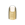

`{{key|gesture|Finger Side}}`

### 点击并长按

`{{key|gesture|Tap}}`

`{{key|gesture|Double Tap}}`

`{{key|gesture|Hold}}`
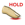

### 滑动动作

`{{key|gesture|Swipe Bottom Left}}`

`{{key|gesture|Swipe Bottom Right}}`

`{{key|gesture|Swipe Down}}`
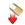

`{{key|gesture|Swipe Left}}`

`{{key|gesture|Swipe Right}}`
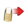

`{{key|gesture|Swipe Top Left}}`

`{{key|gesture|Swipe Top Right}}`

`{{key|gesture|Swipe Up}}`
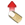

### 缩放与滚动

`{{key|gesture|Zoom In}}`
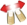

`{{key|gesture|Zoom Out}}`

`{{key|gesture|Scroll Down}}`

`{{key|gesture|Scroll Left}}`
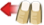

`{{key|gesture|Scroll Right}}`

`{{key|gesture|Scroll Up}}`

### 圆周运动

`{{key|gesture|Double Rotate}`
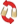

`{{key|gesture|Full Circle}}`

`{{key|gesture|Half Circle}}`
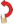

`{{key|gesture|Quarter Circle}}`

图片来源：[dev:Category:Xbox input images](https://commons.wiki.gg/wiki/Category%3AXbox_input_images)

### 系列与单品

`{{Key|Xbox|A}}`

`{{Key|Xbox|B}}`

`{{Key|Xbox|X}}`

`{{Key|Xbox|Y}}`

`{{Key|Xbox|Left Thumbstick}}`

`{{Key|Xbox|Right Thumbstick}}`

`{{Key|Xbox|Left Thumbstick Press}}`
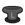

`{{Key|Xbox|Right Thumbstick Press}}`

`{{Key|Xbox|LB}}`

`{{Key|Xbox|RB}}`

`{{Key|Xbox|View}}`

`{{Key|Xbox|Menu}}`

`{{Key|Xbox|Button}}`

### Xbox Series

`{{Key|Xbox|D-pad}}`

`{{Key|Xbox|D-pad Left}}`

`{{Key|Xbox|D-pad Right}}`

`{{Key|Xbox|D-pad Up}}`

`{{Key|Xbox|D-pad Down}}`

`{{Key|Xbox|LT}}`

`{{Key|Xbox|RT}}`

`{{Key|Xbox|Share}}`

#### 图表

`{{Key|Xbox|Series Controller Diagram}}`

### Xbox One

`{{Key|Xbox|One D-pad}}`

`{{Key|Xbox|One D-pad Left}}`

`{{Key|Xbox|One D-pad Right}}`

`{{Key|Xbox|One D-pad Up}}`

`{{Key|Xbox|One D-pad Down}}`

`{{Key|Xbox|One Left Trigger}}`

`{{Key|Xbox|One Right Trigger}}`
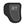

#### 图表

`{{Key|Xbox|One Controller Diagram}}`

图片来源：[dev:Category:DualSense input images](https://commons.wiki.gg/wiki/Category%3ADualSense_input_images)

### 按钮

`{{Key|PS|Directional}}`

`{{Key|PS|Directional Left}}`

`{{Key|PS|Directional Right}}`

`{{Key|PS|Directional Up}}`

`{{Key|PS|Directional Down}}`

`{{Key|PS|Left Stick}}`

`{{Key|PS|Right Stick}}`

`{{Key|PS|Touch Pad}}`

`{{Key|PS|Circle}}`

`{{Key|PS|Cross}}`

`{{Key|PS|Square}}`

`{{Key|PS|Triangle}}`

`{{Key|PS|Create}}`

`{{Key|PS|Options}}`

`{{Key|PS|L1}}`

`{{Key|PS|R1}}`

`{{Key|PS|L2}}`
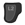

`{{Key|PS|R2}}`

`{{Key|PS|L3}}`
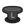

`{{Key|PS|R3}}`
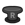

`{{Key|PS|Mute}}`

`{{Key|PS|PS}}`

### 图表

`{{Key|PS|Controller Diagram}}`

图片来源：[dev:分类:PS4 输入图片](https://commons.wiki.gg/wiki/Category%3APS4_input_images)

### 方向键与摇杆

`{{key|PS4|Dpad}}`

`{{key|PS4|Left}}`

`{{key|PS4|Right}}`

`{{key|PS4|Up}}`

`{{key|PS4|Down}}`

`{{key|PS4|Left Stick}}`

`{{key|PS4|Right Stick}}`

`{{key|PS4|Touch Pad}}`

### 前按钮

`{{key|PS4|Circle}}`

`{{key|PS4|Cross}}`

`{{key|PS4|Square}}`

`{{key|PS4|Triangle}}`

`{{key|PS4|Share}}`

`{{key|PS4|Options}}`

### 后盖按钮

`{{key|PS4|L1}}`

`{{key|PS4|R1}}`

`{{key|PS4|L2}}`

`{{key|PS4|R2}}`
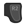

图片来源：[dev:Category:Nintendo Switch input images](https://commons.wiki.gg/wiki/Category%3ANintendo_Switch_input_images)

### Nintendo Switch

`{{Key|Switch|a}}`

`{{Key|Switch|b}}`

`{{Key|Switch|x}}`

`{{Key|Switch|y}}`

`{{Key|Switch|Left Stick}}`

`{{Key|Switch|Right Stick}}`

`{{Key|Switch|Left Stick Press}}`

`{{Key|Switch|Right Stick Press}}`

`{{Key|Switch|-}}`

`{{Key|Switch|+}}`

`{{Key|Switch|Capture}}`

`{{Key|Switch|HOME}}`

`{{Key|Switch|L}}`

`{{Key|Switch|R}}`

`{{Key|Switch|ZL}}`

`{{Key|Switch|ZR}}`

### Pro控制器

`{{Key|Switch|Pro Control Pad}}`

`{{Key|Switch|Pro Control Pad Left}}`

`{{Key|Switch|Pro Control Pad Right}}`

`{{Key|Switch|Pro Control Pad Up}}`

`{{Key|Switch|Pro Control Pad Down}}`

### Joy-Con

`{{Key|Switch|Directional Left}}`

`{{Key|Switch|Directional Right}}`

`{{Key|Switch|Directional Up}}`

`{{Key|Switch|Directional Down}}`

#### 图表

`{{Key|Switch|Joy-Con}}`

`{{Key|Switch|Joy-Con Separate}}`

`{{Key|Switch|Joy-Con Left}}`

`{{Key|Switch|Joy-Con Right}}`

图片来源：[dev:Category:Nintendo GameCube 输入图像](https://commons.wiki.gg/wiki/Category%3ANintendo_GameCube_input_images)

### 控制器

`{{Key|GameCube|controller}}` 

### 面部按钮

`{{Key|GameCube|A}}` 

`{{Key|GameCube|A outline}}` 

`{{Key|GameCube|A color}}` 

`{{Key|GameCube|A color outline}}` 

`{{Key|GameCube|B}}` 

`{{Key|GameCube|B outline}}` 

`{{Key|GameCube|B color}}` 

`{{Key|GameCube|B color outline}}` 

`{{Key|GameCube|X}}` 

`{{Key|GameCube|X outline}}` 

`{{Key|GameCube|Y}}` 

`{{Key|GameCube|Y outline}}` 

### 其他按钮

`{{Key|GameCube|start}}` 

`{{Key|GameCube|start outline}}` 

`{{Key|GameCube|left trigger}}` 

`{{Key|GameCube|left trigger outline}}` 

`{{Key|GameCube|right trigger}}` 

`{{Key|GameCube|right trigger outline}}` 

`{{Key|GameCube|Z}}` 

`{{Key|GameCube|Z outline}}` 

`{{Key|GameCube|Z color}}` 

`{{Key|GameCube|Z color outline}}` 

### 左摇杆

`{{Key|GameCube|stick}}` 

`{{Key|GameCube|stick left}}` 

`{{Key|GameCube|stick right}}` 

`{{Key|GameCube|stick horizontal}}` 

`{{Key|GameCube|stick up}}` 

`{{Key|GameCube|stick down}}` 

`{{Key|GameCube|stick vertical}}` 

### C 摇杆（C-stick）

`{{Key|GameCube|c stick}}` 

`{{Key|GameCube|c stick color}}` 

`{{Key|GameCube|c stick left}}` 

`{{Key|GameCube|c stick left color}}` 

`{{Key|GameCube|c stick right}}` 

`{{Key|GameCube|c stick right color}}` 

`{{Key|GameCube|c stick horizontal}}` 

`{{Key|GameCube|c stick horizontal color}}` 

`{{Key|GameCube|c stick up}}` 

`{{Key|GameCube|c stick up color}}` 

`{{Key|GameCube|c stick down}}` 

`{{Key|GameCube|c stick down color}}` 

`{{Key|GameCube|c stick vertical}}` 

`{{Key|GameCube|c stick vertical color}}` 

### 方向键

`{{Key|GameCube|dpad}}` 

`{{Key|GameCube|dpad outline}}` 

`{{Key|GameCube|dpad all}}` 

`{{Key|GameCube|dpad left}}` 

`{{Key|GameCube|dpad left outline}}` 

`{{Key|GameCube|dpad right}}` 

`{{Key|GameCube|dpad right outline}}` 

`{{Key|GameCube|dpad horizontal}}` 

`{{Key|GameCube|dpad horizontal outline}}` 

`{{Key|GameCube|dpad up}}` 

`{{Key|GameCube|dpad up outline}}` 

`{{Key|GameCube|dpad down}}` 

`{{Key|GameCube|dpad down outline}}` 

`{{Key|GameCube|dpad vertical}}` 

`{{Key|GameCube|dpad vertical outline}}` 

**分类**　[分类 · 使用 Tabber 解析器的页面](../categories/Pages_using_Tabber_parser_tag.md) · [分类 · 关键模板文档](../categories/Key_template_documentation.md)

[返回总入口](../%E7%90%83%E6%AF%94%E4%BC%A6%E6%88%98%E8%AE%B0%20Wiki.md) · [返回本分目录](%E7%9B%AE%E5%BD%95.md)
