# 模板 · 关键/文档（Key/doc）

[原文与贡献者记录](https://ballxpit.wiki.gg/wiki/Template:Key%2Fdoc) · [修订 508](https://ballxpit.wiki.gg/index.php?oldid=508) · [返回目录](../%E7%90%83%E6%AF%94%E4%BC%A6%E6%88%98%E8%AE%B0%20Wiki.md)

这是用于显示控件、按钮和密钥的图标模板， 来自计算机键盘或视频游戏控制器。

模板参数 此模板更倾向于参数的内嵌格式化。

| 参数 |  | 描述 | 类型 | 状态 |
| --- | --- | --- | --- | --- |
| 控制台或设备 | `1` | 控制器或设备的控制器控制台或设备，要显示按钮 建议数值`Keyboard` `Gesture` `Xbox` `PS5` `PS4` `PS3` `Switch` `Wii` `GameCube` | 字符串字符串 | 可选 |
| 键或按键 | `2` | 要显示的密钥名或按钮名称 | 字符串字符串 | 可选 |

#### 实例实例实例

[桌面](#%E9%94%AE%E7%9B%98%E9%94%AE%E7%9B%98)[流动移动](#%E6%8C%87%E9%92%88)[X 框](#%E7%B3%BB%E5%88%97%E5%92%8C%E4%B8%80)[双感](#%E6%8C%89%E9%92%AE)[播放台 4](#d-pad-%E6%A3%92%E6%A3%92)[Nintendo Switch](#nintendo-switch)[任天堂游戏立方体](#%E4%B8%BB%E8%AE%A1%E9%95%BF)

图像来源 : [dev:Category: Desktop 输入图像](https://commons.wiki.gg/wiki/Category%3ADesktop_input_images)

##### 键盘键盘

`{{Key|Keyboard|A}}` 

`{{Key|Keyboard|A outline}}` 

##### 鼠标

`{{Key|Keyboard|Left}}` 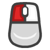

`{{Key|Keyboard|Right}}` 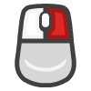

图像来源: [dev:Category:Gesture 输入图像](https://commons.wiki.gg/wiki/Category%3AGesture_input_images)

##### 指针

`{{key|gesture|Finger Front}}`
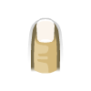

`{{key|gesture|Finger Side}}`
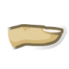

##### Tap 挂挂( H)

`{{key|gesture|Tap}}`
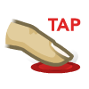

`{{key|gesture|Double Tap}}`
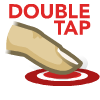

`{{key|gesture|Hold}}`
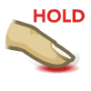

##### 撤销请求

`{{key|gesture|Swipe Bottom Left}}`
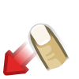

`{{key|gesture|Swipe Bottom Right}}`
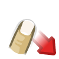

`{{key|gesture|Swipe Down}}`
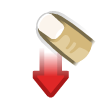

`{{key|gesture|Swipe Left}}`
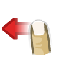

`{{key|gesture|Swipe Right}}`
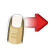

`{{key|gesture|Swipe Top Left}}`
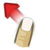

`{{key|gesture|Swipe Top Right}}`
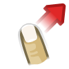

`{{key|gesture|Swipe Up}}`
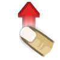

##### 缩放滚动( L)

`{{key|gesture|Zoom In}}`
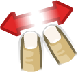

`{{key|gesture|Zoom Out}}`
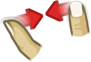

`{{key|gesture|Scroll Down}}`
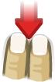

`{{key|gesture|Scroll Left}}`
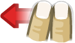

`{{key|gesture|Scroll Right}}`
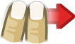

`{{key|gesture|Scroll Up}}`
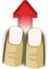

##### 通知动议

`{{key|gesture|Double Rotate}`
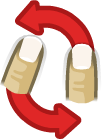

`{{key|gesture|Full Circle}}`
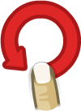

`{{key|gesture|Half Circle}}`
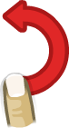

`{{key|gesture|Quarter Circle}}`
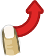

图像来源: [dev: 类型: Xbox 输入图像](https://commons.wiki.gg/wiki/Category%3AXbox_input_images)

##### 系列和一

`{{Key|Xbox|A}}`

`{{Key|Xbox|B}}`

`{{Key|Xbox|X}}`

`{{Key|Xbox|Y}}`

`{{Key|Xbox|Left Thumbstick}}`
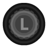

`{{Key|Xbox|Right Thumbstick}}`

`{{Key|Xbox|Left Thumbstick Press}}`
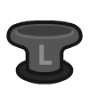

`{{Key|Xbox|Right Thumbstick Press}}`
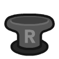

`{{Key|Xbox|LB}}`
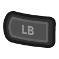

`{{Key|Xbox|RB}}`
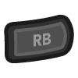

`{{Key|Xbox|View}}`

`{{Key|Xbox|Menu}}`

`{{Key|Xbox|Button}}`

##### Xbox 系列

`{{Key|Xbox|D-pad}}`
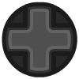

`{{Key|Xbox|D-pad Left}}`
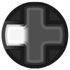

`{{Key|Xbox|D-pad Right}}`
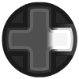

`{{Key|Xbox|D-pad Up}}`
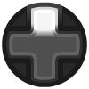

`{{Key|Xbox|D-pad Down}}`
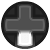

`{{Key|Xbox|LT}}`
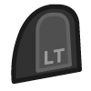

`{{Key|Xbox|RT}}`

`{{Key|Xbox|Share}}`
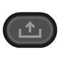

###### 图表图

`{{Key|Xbox|Series Controller Diagram}}`

##### X框一

`{{Key|Xbox|One D-pad}}`

`{{Key|Xbox|One D-pad Left}}`

`{{Key|Xbox|One D-pad Right}}`

`{{Key|Xbox|One D-pad Up}}`

`{{Key|Xbox|One D-pad Down}}`

`{{Key|Xbox|One Left Trigger}}`
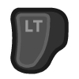

`{{Key|Xbox|One Right Trigger}}`
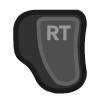

###### 图表图

`{{Key|Xbox|One Controller Diagram}}`

图像来源: [dev:Category:DualSense 输入图像](https://commons.wiki.gg/wiki/Category%3ADualSense_input_images)

##### 按钮

`{{Key|PS|Directional}}`
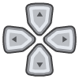

`{{Key|PS|Directional Left}}`
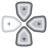

`{{Key|PS|Directional Right}}`
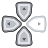

`{{Key|PS|Directional Up}}`
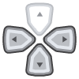

`{{Key|PS|Directional Down}}`
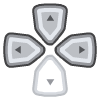

`{{Key|PS|Left Stick}}`
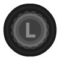

`{{Key|PS|Right Stick}}`

`{{Key|PS|Touch Pad}}`
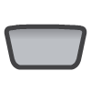

`{{Key|PS|Circle}}`
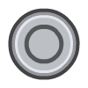

`{{Key|PS|Cross}}`

`{{Key|PS|Square}}`
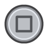

`{{Key|PS|Triangle}}`

`{{Key|PS|Create}}`

`{{Key|PS|Options}}`

`{{Key|PS|L1}}`

`{{Key|PS|R1}}`

`{{Key|PS|L2}}`

`{{Key|PS|R2}}`

`{{Key|PS|L3}}`

`{{Key|PS|R3}}`

`{{Key|PS|Mute}}`

`{{Key|PS|PS}}`

##### 图表图

`{{Key|PS|Controller Diagram}}`

图像来源: [dev:Category:PS4输入图像](https://commons.wiki.gg/wiki/Category%3APS4_input_images)

##### D-pad 棒棒

`{{key|PS4|Dpad}}`

`{{key|PS4|Left}}`

`{{key|PS4|Right}}`

`{{key|PS4|Up}}`

`{{key|PS4|Down}}`

`{{key|PS4|Left Stick}}`

`{{key|PS4|Right Stick}}`

`{{key|PS4|Touch Pad}}`

##### 前按钮

`{{key|PS4|Circle}}`

`{{key|PS4|Cross}}`

`{{key|PS4|Square}}`

`{{key|PS4|Triangle}}`

`{{key|PS4|Share}}`

`{{key|PS4|Options}}`

##### 后拉按钮

`{{key|PS4|L1}}`

`{{key|PS4|R1}}`

`{{key|PS4|L2}}`

`{{key|PS4|R2}}`

图像来源: [dev:Category:Nintendo开关输入图像](https://commons.wiki.gg/wiki/Category%3ANintendo_Switch_input_images)

##### Nintendo Switch

`{{Key|Switch|a}}`

`{{Key|Switch|b}}`

`{{Key|Switch|x}}`

`{{Key|Switch|y}}`

`{{Key|Switch|Left Stick}}`

`{{Key|Switch|Right Stick}}`

`{{Key|Switch|Left Stick Press}}`

`{{Key|Switch|Right Stick Press}}`

`{{Key|Switch|-}}`

`{{Key|Switch|+}}`

`{{Key|Switch|Capture}}`

`{{Key|Switch|HOME}}`

`{{Key|Switch|L}}`

`{{Key|Switch|R}}`

`{{Key|Switch|ZL}}`

`{{Key|Switch|ZR}}`

##### 代理主计长

`{{Key|Switch|Pro Control Pad}}`

`{{Key|Switch|Pro Control Pad Left}}`

`{{Key|Switch|Pro Control Pad Right}}`

`{{Key|Switch|Pro Control Pad Up}}`

`{{Key|Switch|Pro Control Pad Down}}`

##### 欢乐会

`{{Key|Switch|Directional Left}}`

`{{Key|Switch|Directional Right}}`

`{{Key|Switch|Directional Up}}`

`{{Key|Switch|Directional Down}}`

###### 图表图

`{{Key|Switch|Joy-Con}}`

`{{Key|Switch|Joy-Con Separate}}`

`{{Key|Switch|Joy-Con Left}}`

`{{Key|Switch|Joy-Con Right}}`

图像来源: [dev:Category:Nintendo GameCube 输入图像](https://commons.wiki.gg/wiki/Category%3ANintendo_GameCube_input_images)

##### 主计长

`{{Key|GameCube|controller}}` 

##### 面边按钮

`{{Key|GameCube|A}}` 

`{{Key|GameCube|A outline}}` 

`{{Key|GameCube|A color}}` 

`{{Key|GameCube|A color outline}}` 

`{{Key|GameCube|B}}` 

`{{Key|GameCube|B outline}}` 

`{{Key|GameCube|B color}}` 

`{{Key|GameCube|B color outline}}` 

`{{Key|GameCube|X}}` 

`{{Key|GameCube|X outline}}` 

`{{Key|GameCube|Y}}` 

`{{Key|GameCube|Y outline}}` 

##### 其他按钮

`{{Key|GameCube|start}}` 

`{{Key|GameCube|start outline}}` 

`{{Key|GameCube|left trigger}}` 

`{{Key|GameCube|left trigger outline}}` 

`{{Key|GameCube|right trigger}}` 

`{{Key|GameCube|right trigger outline}}` 

`{{Key|GameCube|Z}}` 

`{{Key|GameCube|Z outline}}` 

`{{Key|GameCube|Z color}}` 

`{{Key|GameCube|Z color outline}}` 

##### 左边棍

`{{Key|GameCube|stick}}` 

`{{Key|GameCube|stick left}}` 

`{{Key|GameCube|stick right}}` 

`{{Key|GameCube|stick horizontal}}` 

`{{Key|GameCube|stick up}}` 

`{{Key|GameCube|stick down}}` 

`{{Key|GameCube|stick vertical}}` 

##### C-棒棒

`{{Key|GameCube|c stick}}` 

`{{Key|GameCube|c stick color}}` 

`{{Key|GameCube|c stick left}}` 

`{{Key|GameCube|c stick left color}}` 

`{{Key|GameCube|c stick right}}` 

`{{Key|GameCube|c stick right color}}` 

`{{Key|GameCube|c stick horizontal}}` 

`{{Key|GameCube|c stick horizontal color}}` 

`{{Key|GameCube|c stick up}}` 

`{{Key|GameCube|c stick up color}}` 

`{{Key|GameCube|c stick down}}` 

`{{Key|GameCube|c stick down color}}` 

`{{Key|GameCube|c stick vertical}}` 

`{{Key|GameCube|c stick vertical color}}` 

##### 方向面板

`{{Key|GameCube|dpad}}` 

`{{Key|GameCube|dpad outline}}` 

`{{Key|GameCube|dpad all}}` 

`{{Key|GameCube|dpad left}}` 

`{{Key|GameCube|dpad left outline}}` 

`{{Key|GameCube|dpad right}}` 

`{{Key|GameCube|dpad right outline}}` 

`{{Key|GameCube|dpad horizontal}}` 

`{{Key|GameCube|dpad horizontal outline}}` 

`{{Key|GameCube|dpad up}}` 

`{{Key|GameCube|dpad up outline}}` 

`{{Key|GameCube|dpad down}}` 

`{{Key|GameCube|dpad down outline}}` 

`{{Key|GameCube|dpad vertical}}` 

`{{Key|GameCube|dpad vertical outline}}` 

**分类**　[分类 · 使用Tabber解析标签的页面](../categories/Pages_using_Tabber_parser_tag.md) · [分类 · 关键模板文档](../categories/Key_template_documentation.md)

[返回总入口](../%E7%90%83%E6%AF%94%E4%BC%A6%E6%88%98%E8%AE%B0%20Wiki.md) · [返回本分目录](%E7%9B%AE%E5%BD%95.md)
