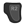

# 模板 · 关键/doc/双向（Key/doc/DualSense）

[原文与贡献者记录](https://ballxpit.wiki.gg/wiki/Template:Key%2Fdoc%2FDualSense) · [修订 509](https://ballxpit.wiki.gg/index.php?oldid=509) · [返回目录](../%E7%90%83%E6%AF%94%E4%BC%A6%E6%88%98%E8%AE%B0%20Wiki.md)

图片来源：[dev:Category:DualSense input images](https://commons.wiki.gg/wiki/Category%3ADualSense_input_images)

### 按钮

`{{Key|PS|Directional}}`

`{{Key|PS|Directional Left}}`

`{{Key|PS|Directional Right}}`

`{{Key|PS|Directional Up}}`

`{{Key|PS|Directional Down}}`

`{{Key|PS|Left Stick}}`

`{{Key|PS|Right Stick}}`

`{{Key|PS|Touch Pad}}`

`{{Key|PS|Circle}}`

`{{Key|PS|Cross}}`

`{{Key|PS|Square}}`

`{{Key|PS|Triangle}}`

`{{Key|PS|Create}}`

`{{Key|PS|Options}}`

`{{Key|PS|L1}}`

`{{Key|PS|R1}}`

`{{Key|PS|L2}}`

`{{Key|PS|R2}}`

`{{Key|PS|L3}}`

`{{Key|PS|R3}}`

`{{Key|PS|Mute}}`

`{{Key|PS|PS}}`

### 图表

`{{Key|PS|Controller Diagram}}`

**分类**　[分类 · 关键模板文档](../categories/Key_template_documentation.md)

[返回总入口](../%E7%90%83%E6%AF%94%E4%BC%A6%E6%88%98%E8%AE%B0%20Wiki.md) · [返回本分目录](%E7%9B%AE%E5%BD%95.md)
