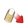
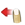
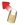
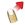

# 模板 · 关键/doc/姿势（Key/doc/Gesture）

[原文与贡献者记录](https://ballxpit.wiki.gg/wiki/Template:Key%2Fdoc%2FGesture) · [修订 510](https://ballxpit.wiki.gg/index.php?oldid=510) · [返回目录](../%E7%90%83%E6%AF%94%E4%BC%A6%E6%88%98%E8%AE%B0%20Wiki.md)

图片来源：[dev:分类：手势输入图片](https://commons.wiki.gg/wiki/Category%3AGesture_input_images)

### 手指

`{{key|gesture|Finger Front}}`

`{{key|gesture|Finger Side}}`

### 点击并长按

`{{key|gesture|Tap}}`

`{{key|gesture|Double Tap}}`

`{{key|gesture|Hold}}`

### 滑动动作

`{{key|gesture|Swipe Bottom Left}}`

`{{key|gesture|Swipe Bottom Right}}`

`{{key|gesture|Swipe Down}}`

`{{key|gesture|Swipe Left}}`

`{{key|gesture|Swipe Right}}`

`{{key|gesture|Swipe Top Left}}`

`{{key|gesture|Swipe Top Right}}`

`{{key|gesture|Swipe Up}}`

### 缩放与滚动

`{{key|gesture|Zoom In}}`

`{{key|gesture|Zoom Out}}`

`{{key|gesture|Scroll Down}}`

`{{key|gesture|Scroll Left}}`

`{{key|gesture|Scroll Right}}`

`{{key|gesture|Scroll Up}}`

### 圆周运动

`{{key|gesture|Double Rotate}`

`{{key|gesture|Full Circle}}`

`{{key|gesture|Half Circle}}`

`{{key|gesture|Quarter Circle}}`

**分类**　[分类 · 关键模板文档](../categories/Key_template_documentation.md)

[返回总入口](../%E7%90%83%E6%AF%94%E4%BC%A6%E6%88%98%E8%AE%B0%20Wiki.md) · [返回本分目录](%E7%9B%AE%E5%BD%95.md)
