# 模板 · 关键/doc/姿势（Key/doc/Gesture）

[原文与贡献者记录](https://ballxpit.wiki.gg/wiki/Template:Key%2Fdoc%2FGesture) · [修订 510](https://ballxpit.wiki.gg/index.php?oldid=510) · [返回目录](../%E7%90%83%E6%AF%94%E4%BC%A6%E6%88%98%E8%AE%B0%20Wiki.md)

图像来源: [dev:Category:Gesture 输入图像](https://commons.wiki.gg/wiki/Category%3AGesture_input_images)

##### 指针

`{{key|gesture|Finger Front}}`
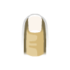

`{{key|gesture|Finger Side}}`
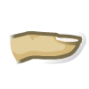

##### Tap 挂挂( H)

`{{key|gesture|Tap}}`
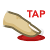

`{{key|gesture|Double Tap}}`
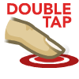

`{{key|gesture|Hold}}`
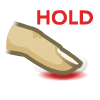

##### 撤销请求

`{{key|gesture|Swipe Bottom Left}}`
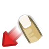

`{{key|gesture|Swipe Bottom Right}}`
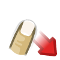

`{{key|gesture|Swipe Down}}`
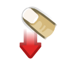

`{{key|gesture|Swipe Left}}`
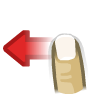

`{{key|gesture|Swipe Right}}`
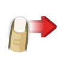

`{{key|gesture|Swipe Top Left}}`
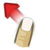

`{{key|gesture|Swipe Top Right}}`
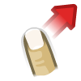

`{{key|gesture|Swipe Up}}`
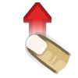

##### 缩放滚动( L)

`{{key|gesture|Zoom In}}`
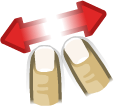

`{{key|gesture|Zoom Out}}`
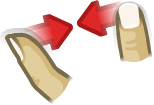

`{{key|gesture|Scroll Down}}`
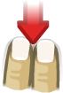

`{{key|gesture|Scroll Left}}`
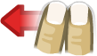

`{{key|gesture|Scroll Right}}`

`{{key|gesture|Scroll Up}}`

##### 通知动议

`{{key|gesture|Double Rotate}`
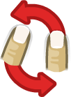

`{{key|gesture|Full Circle}}`
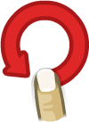

`{{key|gesture|Half Circle}}`

`{{key|gesture|Quarter Circle}}`
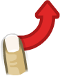

**分类**　[分类 · 关键模板文档](../categories/Key_template_documentation.md)

[返回总入口](../%E7%90%83%E6%AF%94%E4%BC%A6%E6%88%98%E8%AE%B0%20Wiki.md) · [返回本分目录](%E7%9B%AE%E5%BD%95.md)
