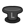
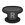
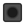

# 模板 · 关键文档/任天堂Switch（Key/doc/Nintendo Switch）

[原文与贡献者记录](https://ballxpit.wiki.gg/wiki/Template:Key%2Fdoc%2FNintendo_Switch) · [修订 511](https://ballxpit.wiki.gg/index.php?oldid=511) · [返回目录](../%E7%90%83%E6%AF%94%E4%BC%A6%E6%88%98%E8%AE%B0%20Wiki.md)

图片来源：[dev:Category:Nintendo Switch input images](https://commons.wiki.gg/wiki/Category%3ANintendo_Switch_input_images)

### Nintendo Switch

`{{Key|Switch|a}}`

`{{Key|Switch|b}}`

`{{Key|Switch|x}}`

`{{Key|Switch|y}}`

`{{Key|Switch|Left Stick}}`

`{{Key|Switch|Right Stick}}`

`{{Key|Switch|Left Stick Press}}`

`{{Key|Switch|Right Stick Press}}`

`{{Key|Switch|-}}`

`{{Key|Switch|+}}`

`{{Key|Switch|Capture}}`

`{{Key|Switch|HOME}}`

`{{Key|Switch|L}}`

`{{Key|Switch|R}}`

`{{Key|Switch|ZL}}`

`{{Key|Switch|ZR}}`

### Pro控制器

`{{Key|Switch|Pro Control Pad}}`

`{{Key|Switch|Pro Control Pad Left}}`

`{{Key|Switch|Pro Control Pad Right}}`

`{{Key|Switch|Pro Control Pad Up}}`

`{{Key|Switch|Pro Control Pad Down}}`

### Joy-Con

`{{Key|Switch|Directional Left}}`

`{{Key|Switch|Directional Right}}`

`{{Key|Switch|Directional Up}}`

`{{Key|Switch|Directional Down}}`

#### 图表

`{{Key|Switch|Joy-Con}}`

`{{Key|Switch|Joy-Con Separate}}`

`{{Key|Switch|Joy-Con Left}}`

`{{Key|Switch|Joy-Con Right}}`

**分类**　[分类 · 关键模板文档](../categories/Key_template_documentation.md)

[返回总入口](../%E7%90%83%E6%AF%94%E4%BC%A6%E6%88%98%E8%AE%B0%20Wiki.md) · [返回本分目录](%E7%9B%AE%E5%BD%95.md)
