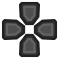
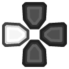
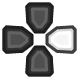
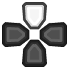
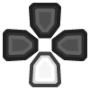
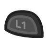
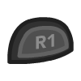
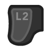
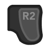

# 模板 · 关键/doc/PS4（Key/doc/PS4）

[原文与贡献者记录](https://ballxpit.wiki.gg/wiki/Template:Key%2Fdoc%2FPS4) · [修订 512](https://ballxpit.wiki.gg/index.php?oldid=512) · [返回目录](../%E7%90%83%E6%AF%94%E4%BC%A6%E6%88%98%E8%AE%B0%20Wiki.md)

图像来源: [dev:Category:PS4输入图像](https://commons.wiki.gg/wiki/Category%3APS4_input_images)

##### D-pad 棒棒

`{{key|PS4|Dpad}}`

`{{key|PS4|Left}}`

`{{key|PS4|Right}}`

`{{key|PS4|Up}}`

`{{key|PS4|Down}}`

`{{key|PS4|Left Stick}}`

`{{key|PS4|Right Stick}}`

`{{key|PS4|Touch Pad}}`

##### 前按钮

`{{key|PS4|Circle}}`

`{{key|PS4|Cross}}`

`{{key|PS4|Square}}`

`{{key|PS4|Triangle}}`

`{{key|PS4|Share}}`

`{{key|PS4|Options}}`

##### 后拉按钮

`{{key|PS4|L1}}`

`{{key|PS4|R1}}`

`{{key|PS4|L2}}`

`{{key|PS4|R2}}`

**分类**　[分类 · 关键模板文档](../categories/Key_template_documentation.md)

[返回总入口](../%E7%90%83%E6%AF%94%E4%BC%A6%E6%88%98%E8%AE%B0%20Wiki.md) · [返回本分目录](%E7%9B%AE%E5%BD%95.md)
