# 模板 · 密钥/doc/Xbox（Key/doc/Xbox）

[原文与贡献者记录](https://ballxpit.wiki.gg/wiki/Template:Key%2Fdoc%2FXbox) · [修订 513](https://ballxpit.wiki.gg/index.php?oldid=513) · [返回目录](../%E7%90%83%E6%AF%94%E4%BC%A6%E6%88%98%E8%AE%B0%20Wiki.md)

图像来源: [dev: 类型: Xbox 输入图像](https://commons.wiki.gg/wiki/Category%3AXbox_input_images)

##### 系列和一

`{{Key|Xbox|A}}`

`{{Key|Xbox|B}}`

`{{Key|Xbox|X}}`

`{{Key|Xbox|Y}}`

`{{Key|Xbox|Left Thumbstick}}`

`{{Key|Xbox|Right Thumbstick}}`

`{{Key|Xbox|Left Thumbstick Press}}`
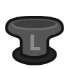

`{{Key|Xbox|Right Thumbstick Press}}`
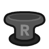

`{{Key|Xbox|LB}}`
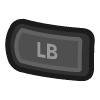

`{{Key|Xbox|RB}}`
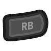

`{{Key|Xbox|View}}`

`{{Key|Xbox|Menu}}`

`{{Key|Xbox|Button}}`
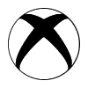

##### Xbox 系列

`{{Key|Xbox|D-pad}}`

`{{Key|Xbox|D-pad Left}}`
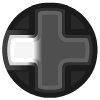

`{{Key|Xbox|D-pad Right}}`
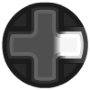

`{{Key|Xbox|D-pad Up}}`

`{{Key|Xbox|D-pad Down}}`
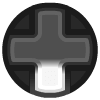

`{{Key|Xbox|LT}}`
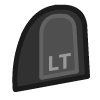

`{{Key|Xbox|RT}}`

`{{Key|Xbox|Share}}`
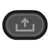

###### 图表图

`{{Key|Xbox|Series Controller Diagram}}`

##### X框一

`{{Key|Xbox|One D-pad}}`

`{{Key|Xbox|One D-pad Left}}`

`{{Key|Xbox|One D-pad Right}}`

`{{Key|Xbox|One D-pad Up}}`

`{{Key|Xbox|One D-pad Down}}`

`{{Key|Xbox|One Left Trigger}}`
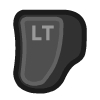

`{{Key|Xbox|One Right Trigger}}`
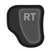

###### 图表图

`{{Key|Xbox|One Controller Diagram}}`

**分类**　[分类 · 关键模板文档](../categories/Key_template_documentation.md)

[返回总入口](../%E7%90%83%E6%AF%94%E4%BC%A6%E6%88%98%E8%AE%B0%20Wiki.md) · [返回本分目录](%E7%9B%AE%E5%BD%95.md)
