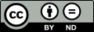

# 模板 · 许可证/CC-BY-ND（License/CC-BY-ND）

[原文与贡献者记录](https://ballxpit.wiki.gg/wiki/Template:License%2FCC-BY-ND) · [修订 525](https://ballxpit.wiki.gg/index.php?oldid=525) · [返回目录](../%E7%90%83%E6%AF%94%E4%BC%A6%E6%88%98%E8%AE%B0%20Wiki.md)

此模板目前看起来像 :

此文件在 [创用CC授权- NoDerivs 3.0许可](https://creativecommons.org/licenses/by-nd/3.0/).

见见 `{{[License](License.md)}}` 持有全许可证证件

**分类**　[分类 · 许可证模板](../categories/License_templates.md)

[返回总入口](../%E7%90%83%E6%AF%94%E4%BC%A6%E6%88%98%E8%AE%B0%20Wiki.md) · [返回本分目录](%E7%9B%AE%E5%BD%95.md)
