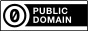

# 模板 · 许可证/CC0（License/CC0）

[原文与贡献者记录](https://ballxpit.wiki.gg/wiki/Template:License%2FCC0) · [修订 533](https://ballxpit.wiki.gg/index.php?oldid=533) · [返回目录](../%E7%90%83%E6%AF%94%E4%BC%A6%E6%88%98%E8%AE%B0%20Wiki.md)

此模板目前看起来像 :

此文件在 [CC0 1.0许可证](https://creativecommons.org/publicdomain/zero/1.0/).

见见 `{{[License](License.md)}}` 持有全许可证证件

**分类**　[分类 · 许可证模板](../categories/License_templates.md)

[返回总入口](../%E7%90%83%E6%AF%94%E4%BC%A6%E6%88%98%E8%AE%B0%20Wiki.md) · [返回本分目录](%E7%9B%AE%E5%BD%95.md)
