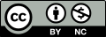

# 模板 · 许可证/模板（License/template）

[原文与贡献者记录](https://ballxpit.wiki.gg/wiki/Template:License%2Ftemplate) · [修订 547](https://ballxpit.wiki.gg/index.php?oldid=547) · [返回目录](../%E7%90%83%E6%AF%94%E4%BC%A6%E6%88%98%E8%AE%B0%20Wiki.md)

| 模板文档 |
| --- |
| *注:未提供值，模板样本的某些部分可能无法见。* |
| 查看或编辑 [此文档](License_doc.md) ( [关于模板文档](Documentation.md)) |
| 编辑器可以在此模板 [sandbox](https://ballxpit.wiki.gg/wiki/Template:License/template/sandbox?action=edit) 和 [测试案例](https://ballxpit.wiki.gg/wiki/Template:License/template/testcases) 页面上进行实验。 |

此模板将在文件页上的*许可* 标题下使用，以表示文件的许可证。

[ ]

#### 目录（Contents）

* [1 现有许可证](#%E7%8E%B0%E6%9C%89%E8%AE%B8%E5%8F%AF%E8%AF%81)
  + [1.1 游戏](#%E6%B8%B8%E6%88%8F)
  + [1.2 公平性](#%E5%85%AC%E5%B9%B3%E6%80%A7)
  + [1.3 CC0](#cc0)
  + [1.4 CC-BY-NC-ND (英语)。](#cc-by-nc-nd-%E8%8B%B1%E8%AF%AD)
  + [1.5 CC-BY-NC-SA (英语)。](#cc-by-nc-sa-%E8%8B%B1%E8%AF%AD)
  + [1.6 CC-BY-NC (英语)。](#cc-by-nc-%E8%8B%B1%E8%AF%AD)
  + [1.7 CC-BY-ND (英语)。](#cc-by-nd-%E8%8B%B1%E8%AF%AD)
  + [1.8 美国联邦政府](#%E7%BE%8E%E5%9B%BD%E8%81%94%E9%82%A6%E6%94%BF%E5%BA%9C)
  + [1.9 CC-BY (英语)。](#cc-by-%E8%8B%B1%E8%AF%AD)
  + [1.10 CCPD-CCPD 共同共同市场](#ccpd-ccpd-%E5%85%B1%E5%90%8C%E5%85%B1%E5%90%8C%E5%B8%82%E5%9C%BA)
  + [1.11 CC-SRR (中文(简体) )。](#cc-srr-%E4%B8%AD%E6%96%87%E7%AE%80%E4%BD%93-)
  + [1.12 许可证](#%E8%AE%B8%E5%8F%AF%E8%AF%81)
  + [1.13 无执照](#%E6%97%A0%E6%89%A7%E7%85%A7)
* [2 指定源代码](#%E6%8C%87%E5%AE%9A%E6%BA%90%E4%BB%A3%E7%A0%81)

#### 现有许可证

##### 游戏

* 用法: 利肯斯・游戏~~

此文件为 [Kenny Sun](../articles/Kenny_Sun.md) 和(或)其许可人。
档案中存在的所有商标和注册商标均为 [Kenny Sun](../articles/Kenny_Sun.md) 和(或)其许可人。

##### 公平性

* 用法: 利肯斯公平

此文件有版权使用权。 使用方式将符合以下条件的公平使用: [美国版权法](https://en.wikipedia.org/wiki/Fair_use#Fair_use_under_United_States_law).

##### CC0

* 使用量: QQLicense CC0===

此文件在 [CC0 1.0许可证](https://creativecommons.org/publicdomain/zero/1.0/).

##### CC-BY-NC-ND (英语)。

* 用法：{{License|CC-BY-NC-ND}}

此文件在 [创用CC授权 - 非商业 - NoDerivs 3.0许可](https://creativecommons.org/licenses/by-nc-nd/3.0/).

##### CC-BY-NC-SA (英语)。

* 用法：{{License|CC-BY-NC-SA}}

此文件在 [类似3.0的许可证](https://creativecommons.org/licenses/by-nc-sa/3.0/).

##### CC-BY-NC (英语)。

* 用法：{{License|CC-BY-NC}}

此文件在 [知识共享署名－非商业性使用 3.0 许可协议（CC BY-NC 3.0）](https://creativecommons.org/licenses/by-nc/3.0/).

##### CC-BY-ND (英语)。

* 用法：{{License|CC-BY-ND}}

此文件在 [创用CC授权- NoDerivs 3.0许可](https://creativecommons.org/licenses/by-nd/3.0/).

##### 美国联邦政府

* 用法：{{License|CC-BY-SA}}

此文件在 [知识共享署名－相同方式共享 3.0 许可协议（CC BY-SA 3.0）](https://creativecommons.org/licenses/by-sa/3.0/).

##### CC-BY (英语)。

* 用法: 利肯斯 CC-BY

此文件在 [3.0许可](https://creativecommons.org/licenses/by/3.0/).

##### CCPD-CCPD 共同共同市场

* 用法: 利肯斯 CC-PD

版权持有者已将其档案公之于众，其版权已经过期，或没有版权资格。这在全世界适用。

##### CC-SRR (中文(简体) )。

* 用法: QQLICENSENCE CC-SRR QX

本文由创用CC授权使用。

##### 许可证

* 用法：{{License|permission}}

此文件为版权文件。 版权持有者已允许在 wiki. gg 上使用它。

##### 无执照

**提供无参数( 或无效的参数) 默认值**

{{License}}

请为此文件选择合适的许可， 将正确的参数添加到 \\\ license\\\ \ 。 见 [模板:许可证](License.md) 详细信息。

#### 指定源代码

**源参数( 可选) :**

源参数在文件来源处接受 URL 。

示例:

{{License|game|source=https://indie.io/}}

此文件为 [Kenny Sun](../articles/Kenny_Sun.md) 和(或)其许可人。
档案中存在的所有商标和注册商标均为 [Kenny Sun](../articles/Kenny_Sun.md) 和(或)其许可人。
资料来源: [https://indie.io/](https://indie.io/)

**分类**　[分类 · 许可证模板](../categories/License_templates.md)

[返回总入口](../%E7%90%83%E6%AF%94%E4%BC%A6%E6%88%98%E8%AE%B0%20Wiki.md) · [返回本分目录](%E7%9B%AE%E5%BD%95.md)
