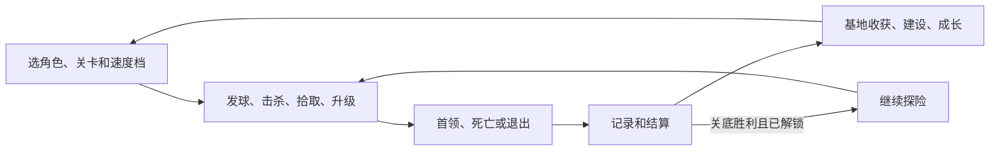

# BALL x PIT 数值深挖清单

这份清单用于接收逆向数据。先把一个基准角色在一个基准关卡里的**发球、弹跳、扣血、刷怪、升级、结算**对齐，再扩到其他角色、球和关卡。文中的字段是要查的内容，表中标为待确认的值以同版本数据和实测为准。

## 循环完整度

Wiki 能串出**下坑战斗 → 通关或失败结算 → 回基地收获与建设 → 强化或解锁 → 再下坑**。局内和局外各有一层缺口。局内缺速度档控制哪些时钟，以及暂停、回合切换和继续探险的状态交接。局外缺各类产出何时开始、何时到账、何时重置，以及强化何时影响下一局。

图里的退出属于待验证分支。下文的[速度与时间推进](#速度与时间推进)和[局外循环的起点与重置](#局外循环的起点与重置)列出了具体取数和核对条件。[体验笔记][notes] · [关卡][levels] · [建筑][buildings] · [冒险者公会][endless]

## 先拿哪一批

| 批次 | 从哪些对象下手 | 第一批要拿到的东西 |
| --- | --- | --- |
| P0 战斗基准 | 战士、普通小球、流血、骷髅战士、骸骨墓园普通档 | 战士初值、发球和返球时间、球对墙与怪的响应、首个敌人的绝对 HP、波次触发条件、一次标准命中的扣血明细 |
| P0 角色覆盖项 | 快枪手、持盾者、同居者、战术家、临时西西弗斯 | 各自覆写了哪些发射、碰撞、时间或伤害参数。至少核对一种能配对的组合和一种被禁止的组合 |
| P0 构筑与技能 | 流血、灼烧、冻结、炸弹、细胞，普通升级和融合反应堆 | 分级效果、触发顺序、冷却归属、层数与继承规则、升级候选权重、击杀与掉落之间的关系 |
| P0 关卡节奏 | 骸骨墓园从第一波到骷髅王。同关卡加查一档快速和一档新游戏＋ | 每波刷什么、什么时候刷、每种敌人的数量与血量、速度档影响哪些计时器、首领出现和进入下一阶段的判据 |
| P0 时间与循环交接 | 同版本跟完一场战斗、回到基地、完成收获或建设、再次开局 | 拿到速度档对各计时器的作用、胜败和重试的入账时点、建筑收益首次生效的时点。顺带验证离线采集与战室能否同时推进 |
| P1 内容与长线 | 其余角色、其他 7 关、无尽模式、奖杯、基地、人力采集与市场 | 整批数据表、模式间差异、资源闭环、每局能带回什么，以及长期成长曲线 |

### Wiki 已覆盖的对象

| 对象 | 当前归档 | 深挖重点 |
| --- | --- | --- |
| 属性与角色 | 六维主属性。11 个派生项共 66 个系数位置，已填 20 项。角色列表有 23 篇独立角色页和 2 条缺独立页的记录 | 46 个空项、角色初值、装填等散落的应用点、角色专属覆写、双角色合并 |
| 圆球与进化 | 91 条圆球记录，含普通小球。90 个特殊圆球有 270 条等级记录。69 个进化结果有 160 条材料记录 | 分级配置之外的触发、冷却、子球继承、效果叠加、抽取权重 |
| 被动道具 | 54 个基础被动、17 个进化被动。基础被动中 20 个在列表可查，缺独立条目 | 逐级参数、入池条件、运行时应用和与角色能力的冲突 |
| 敌人 | 88 条记录，含 63 个普通敌人、17 个小首领、8 个关底首领。80 条写了相对生命倍率 | 倍率分母、绝对 HP、攻击参数、首领阶段、出生时间和编队。8 个关底首领的 HP 倍率均留空 |
| 关卡与建筑 | 8 个基础关卡。建筑总表有 84 条，含 21 座住房和 8 座奖杯 | 快速档、新游戏＋、无尽的曲线。建筑生效范围、升级与返还、产出量、活跃时间与离线结算 |

[属性][attributes] · [角色][characters] · [圆球表][ball-data] · [分级数值][ball-levels] · [进化材料][recipes] · [被动道具][passives] · [敌人][enemies] · [关卡][levels] · [建筑][buildings]

## 1. 发球、弹跳与战斗结算

| 要深挖的机制 | 具体字段与计算点 | 首批对照 |
| --- | --- | --- |
| 角色移动和瞄准 | 移速初值、加减速、转向、可移动区、瞄准上下限、散射分布、输入缓冲、按住发射和松手行为。速度属性在哪一步参与 | 战士与快枪手对比静止、移动、连续发射 |
| 发射、回收与装填 | 基础发射间隔、每次射出的数量和顺序、在途槽、回收条件、装填计时何时开始、允许连续射击的条件。敏捷影响发射与装填的关系 | 记录同一颗球首次发射、重新可用和再次发射的时间 |
| 球运动与反弹 | 初速度、半径、重力、反弹角、速度保留、最低反弹角、几何碰撞、贴边、角落、穿透次数、同目标重复命中间隔、在途上限、回收判定 | 同一发射角分别撞侧墙、后墙、敌人正面与侧面。补持盾者与物理学家 |
| 六维转换 | 角色初值、E–S 档位系数、每点增量或区间、上限、取整、刷新时机。属性点、奖杯、局内增益在什么位置相加或相乘 | 耐力查最大 HP。力量查主球。领导力查小球数据。速度查球与人。敏捷查暴击与装填。智力分别查三类效果 |
| 直接伤害 | 基础伤害取值范围、球级倍率、敌人朝向、暴击率与倍率、攻方增伤、守方易伤、抗性、最终扣血和显示取整 | 基础球 Wiki 倍率为 133% / 167% / 200%。用普通敌人无状态命中建立基准，再加冻结和方向类被动 |
| 范围、状态、被动伤害 | 各类效果读取哪个派生属性。计算半径、命中人数、每目标命中次数、溢出、免疫和独立暴击。记录事件先后与连锁触发 | 炸弹爆炸、灼烧跳伤、流血按命中结算、冻结易伤、被动召唤各取一例 |
| 玩家受伤和生存 | 接触与投射物伤害、护盾与减伤、受击无敌时间、连续命中间隔、回血、过量治疗、护盾方向、死亡、复活 HP 与清场半径 | 死灵法师记有 25% / 50% / 75% 复活血量，清场范围待取。核对死亡与复活时金币或掉落是否结算 |
| 战场空间和时间 | 可站区、敌人警戒与推进线、滚屏速度、出界后实体状态、暂停菜单、快速档、回合制的游戏时钟与伤害时钟。记录命中停顿和屏幕滚动是否影响计时 | 普通、快速、菜单打开、战术家敌我回合各记录一次同类冷却和刷怪倒计时 |

[属性][attributes] · [伤害][damage] · [圆球][balls] · [枪匠][gunsmith] · [死灵法师][necromancer] · [更新记录][updates]

### 速度与时间推进

同一场对照同时记**真实经过时间、能读到的游戏计时、发球次数、弹跳次数和敌我回合**。切换速度或打开界面时，分别记录每个系统继续、减速、暂停或补算了什么。

| 要区分的量 | 具体取数 | 对照场景 |
| --- | --- | --- |
| 球速、移速与发射频率 | 球的初速度与在途速度、角色移动速度、发射间隔、装填开始和结束。记录速度属性、敏捷、角色和被动各自作用的字段与单位 | 固定速度档，只增加一点速度或敏捷。分别测固定距离的飞行、移动和两次发射的间隔 |
| 快速档与难度 | 普通、Fast 到 Fast+9 的解锁和每档参数。分别读滚屏、刷怪、敌人位移、攻击冷却、弹速、玩家操作窗口、计时器步长、奖励和 HP 的变化 | 同角色和同波次对比普通与快速。保持其他条件一致，再改帧率和新游戏＋档位，确认哪些变化由时间步、速度档和难度分别产生 |
| 收获加速 | 加速从哪一刻生效、实际耗时、收获倒计时、弹跳判定和单位时间采集量。确认结算时是否处理同样数量的接触事件 | 同场地、路线、角色，各跑一次正常和加速收获。更新日志提到过加速导致收获偏少的修复 |
| 界面与暂停 | 暂停、升级选择、反应堆菜单、失败和通关界面各自暂停的对象。查恢复时未处理的刷怪、跳伤、装填和输入是否补跑 | 在状态生效及冷却期间逐个打开界面，记录进入前剩余时间、真实停留和恢复后首次事件 |
| 角色回合 | 战术家的瞄准、球在途、敌方回合、主动召回、升级选择各阶段。取敌方回合秒数，查刷怪、敌弹、状态和冷却各读哪个时间 | 同一状态跨一次自然返球和一次主动召回，核对是否提前换回合以及是否重置计时 |
| 局部控时 | 减速、冻结、时间陷阱和时间停止的对象范围。取受影响的移动、攻击、状态跳伤、剩余时长与解冻顺序。查首领、离开范围和重复施加的差异 | 时间球的陷阱写 2.0 / 2.5 / 3.0 秒。时间停止另有冻结时长和自身冷却，重点查两者在冻结期间各自如何推进 |
| 按事件推进 | 按命中、弹跳、击杀、回合和波次推进的计数。查同帧顺序、重复触发窗口及游戏停顿时是否继续 | 用流血、忏悔者的弹跳增伤和一项定时效果，在普通与快速档重复同类触发 |

[速度与敏捷][attributes] · [战术家][tactician] · [时间球][time-ball] · [时间停止][timestop] · [更新记录][updates]

## 2. 角色要逐个取覆写项

所有角色共用一份基础记录，至少查初始生命、六维点数、基础派生值、初始球与等级、球槽与被动槽、小球数量、发射和移动基准、解锁条件、住房收益。以下是每个角色额外要取的字段。

| 角色 | Wiki 依据 | 追加查找与验证 |
| --- | --- | --- |
| [战士](<BALL x PIT Wiki 中文离线版/articles/The_Warrior.md>) | 流血起手，作为普通规则的对照角色 | 初始六维、默认槽位和发射队列。用其对齐每一项基础测量 |
| [快枪手](<BALL x PIT Wiki 中文离线版/articles/The_Itchy_Finger.md>) | 自动发射，球以两倍基础速度发射。发射时仍可全速移动 | 散射角及分布、连发条件、无球时处理、球速倍数的作用位置、与增加球速和散射的被动如何叠加 |
| [忏悔者](<BALL x PIT Wiki 中文离线版/articles/The_Repentant.md>) | 每次弹跳加 5% 伤害，撞后墙后回程穿透 | 哪些碰撞计入、加算或乘算、上限与重置、回程可触发的效果和回收边界 |
| [同居者](<BALL x PIT Wiki 中文离线版/articles/The_Cohabitants.md>) | 镜像发射，描述给出半伤 | 镜像方向和生成时机、两个实例如何计费、半伤覆盖哪些分支、冷却共享和生成球占槽 |
| [沉思者](<BALL x PIT Wiki 中文离线版/articles/The_Cogitator.md>) | 自动选升级、融合和进化。有策划说明与随机选择描述 | 选项权重、协同筛选、是否可重抽或放逐、自动选择延迟和无候选处理 |
| [潜伏者](<BALL x PIT Wiki 中文离线版/articles/The_Embedded.md>) | 球穿透敌人，撞墙后发生变化 | 第一面墙与任意墙的判定、撞墙后穿透重置、首次及重复命中触发 |
| [暗影](<BALL x PIT Wiki 中文离线版/articles/The_Shade.md>) | 从战场后方发射，基础暴击率 10% | 出生坐标与瞄准基准、出场安全距离、暴击加成叠加、与回收类能力交互 |
| [持盾者](<BALL x PIT Wiki 中文离线版/articles/The_Shieldbearer.md>) | 盾牌能反弹球 | 盾牌宽度与角度、跟随位置、反弹方向、触发弹跳被动的条件、对敌方投射物作用 |
| [挥霍者](<BALL x PIT Wiki 中文离线版/articles/The_Spendthrift.md>) | 同时以宽弧线射出所有球 | 弧宽、球数到角度间距的关系、发射顺序、同帧触发、回收与重装时机 |
| [杂耍者](<BALL x PIT Wiki 中文离线版/articles/The_Juggler.md>) | 球以弧线落在瞄准点，落地后进入反弹 | 落点范围、飞行时间、落地初速、落地前命中屏蔽、落地计为发射或弹跳的判定 |
| [空巢者](<BALL x PIT Wiki 中文离线版/articles/The_Empty_Nester.md>) | 无普通小球，连续发射一种特殊球的多个实例 | 每次实例数、选球队列、在途实例限制、返还规则、领导力是否参与 |
| [自笞者](<BALL x PIT Wiki 中文离线版/articles/The_Flagellant.md>) | 球会在屏幕底部反弹 | 底边的反弹角和速度、回收条件、下边界与墙类触发的关系 |
| [临时西西弗斯](<BALL x PIT Wiki 中文离线版/articles/The_Makeshift_Sisyphus.md>) | 直接命中无伤害，范围和状态增伤。原文有 400% 的表述 | 查最终系数是 ×4 还是 ×5、生成小球与普通弹药的区别、零伤命中能否触发状态和被动 |
| [物理学家](<BALL x PIT Wiki 中文离线版/articles/The_Physicist.md>) | 球受到向屏幕后方的重力，抵达顶部后回收 | 重力加速度、速度上限、撞击响应、顶部消失到回收延迟、与同居者的组合 |
| [战术家](<BALL x PIT Wiki 中文离线版/articles/The_Tactician.md>) | 回合制，发射与回收决定切换。可主动召回 | 敌方回合时长、不同阶段冻结哪些时钟、召回延迟、升级窗口是否推进时间、队长宿舍范围 |
| [激进者](<BALL x PIT Wiki 中文离线版/articles/The_Radical.md>) | 自动移动、发射、选升级和融合 | 决策频率、移动避险阈值、目标优先级、自动使用道具与复活、不同阶段的自动化范围 |
| [驯鹰人](<BALL x PIT Wiki 中文离线版/articles/The_Falconer.md>) | 猎鹰从战场两侧发球，详细说明待补 | 猎鹰轨迹、速度、出生间隔、两侧分球比例、瞄准基准、回收归属 |
| [畅饮者](<BALL x PIT Wiki 中文离线版/articles/The_Carouser.md>) | 球返回时绕角色转动，详细说明待补 | 环绕半径、角速度、持续时间、环绕期间的碰撞与触发、可重新发射的时点 |
| [掘地者](<BALL x PIT Wiki 中文离线版/articles/The_Tunneller.md>) | 球会从上下边缘绕回 | 越界方向、出口坐标、保留速度和朝向、循环上限、越界是否算反弹 |
| [蹑足者](<BALL x PIT Wiki 中文离线版/articles/The_Tiptoer.md>) | 低生命值，普通敌人难以侦测，首领和小首领例外 | HP 修正、距离与视角条件、射击或贴身是否破隐、伤害及威胁获得规则 |
| [白发囤积者](<BALL x PIT Wiki 中文离线版/articles/The_Hoary_Hoarder.md>) | 两个球槽，部分装备槽转成被动槽 | 被动槽增量、基础小球与初始球例外、满槽时入池、融合释放槽位后的更新 |
| [持球者](<BALL x PIT Wiki 中文离线版/articles/The_Ballbearer.md>) | 特殊球槽翻倍，禁用被动道具 | 具体槽位、奖励与升级池筛选、第二角色合并时槽位规则、锁定的被动是否仍生效 |
| [伪救世主](<BALL x PIT Wiki 中文离线版/articles/The_False_Messiah.md>) | Twitch 投票与随机事件。平台和住房规则特殊 | 投票时限、平票及无人投票、随机事件权重、升级池差异、组合与奖杯适用范围 |

角色表另出现 **The Wallbreaker** 和 **The Scrupulous Scoundrel**。先核对版本、可玩状态、正式 ID 和解锁标记。若目标版本有效，再查一次穿墙传送的重置时机和对角反弹的角度约束。配对关系里还有 **The Recollector** 等无独立页名称，先做同样的版本核对。[角色列表][characters] · [匹配机][matchmaker] · [测试版与删减内容][beta]

**双角色必须单独取**。记录主副角色换位、初值选择、槽位、首发球等级、能力优先级、互斥关系、可触发的投票选项，以及两人局外 XP 的发放方式。优先校验快枪手 × 战术家、忏悔者 × 持盾者这类互斥，以及物理学家 × 同居者这种已有修补记录的组合。[匹配机][matchmaker] · [珠宝匠][jeweler] · [更新记录][updates]

## 3. 敌人、波次与首领

### 逐个敌人需要的字段

| 项目 | 要查的内容 | 第一批敌人 |
| --- | --- | --- |
| 血量与碰撞 | 绝对基础 HP、生命倍率的分母、随关卡及难度的缩放、尺寸与碰撞体、可穿透、方向护盾、伤害过滤 | 骷髅战士 1×、骸骨堡垒 6×、骸骨军团 20×。补冰封持盾者和冰封勇士，核对护盾侧或正面 |
| 移动、侦测与接敌 | 推进频率、横移速度、加速、警戒范围、进攻或停止距离、追踪条件、冻结时是否停移动与攻击 | 踏沙者、变形眼镜蛇、冲锋菇。补蹑足者与普通角色的相同站位 |
| 普通攻击与特殊动作 | 接触伤害、攻击间隔、前摇、有效帧、后摇、范围、射弹速度、命中状态、地面标记寿命 | 骷髅弓箭手、白骨弩炮、激光蝗虫、冰封投掷者、虫草喷吐者、爆炸菇 |
| 阵型、组合、生成 | 阵型间距、站位与入场坐标、群组共享血量、骑乘解绑、子怪数量与方向、召唤间隔、最多在场数 | 座狼 × 座狼骑手、远古座狼 × 哥布林军阀、幼虫群和巨型幼虫群、月族晶洞与月灵晶洞 |
| 辅助、控场与免疫 | 治疗量和间隔、强化半径、空中不可命中窗口、抓球容量和释放条件、冻结与魅惑免疫 | 天使眷属女祭司、有翼天使眷属、天使眷属掠夺者、枯瘦劫掠者。Wiki 给后者每次最多抓 3 球 |
| 掉落和计数 | XP 宝石、金币、蓝图、融合反应堆的池和权重。母体与子怪分别如何计入击杀、图鉴和进度 | 普通怪、小首领、关底首领、召唤物各取一组记录 |
| 首领阶段 | 绝对 HP、阶段阈值、状态切换时间、触发距离、招式顺序和抽样权重、无敌窗口、召唤物、场地变化、击败判定和奖励 | 先骷髅王和冰封女王。更新日志提到冰封女王在地下时无法受伤，可用来校对阶段过滤 |

### 依关卡核对编队与关底

| 关卡 | 普通 / 小首领 / 关底 | 首批重点 |
| --- | --- | --- |
| [骸骨墓园](<BALL x PIT Wiki 中文离线版/articles/The_BONExYARD.md>) | 7 / 2 / 1 | 骷髅王。拿基准 1× 敌人的 HP、推进、首波和全关波次。记录白骨弩炮连射 |
| [白雪海岸](<BALL x PIT Wiki 中文离线版/articles/The_SNOWYxSHORES.md>) | 7 / 2 / 1 | 冰封女王。拿破盾方向、冰柱状态时长、钻地阶段和无敌窗口 |
| [边境沙漠](<BALL x PIT Wiki 中文离线版/articles/The_LIMINALxDESERT.md>) | 10 / 2 / 1 | 扭曲之蛇。拿激光、地下现身、旋转平台、碰撞体随形态的变化 |
| [真菌森林](<BALL x PIT Wiki 中文离线版/articles/The_FUNGALxFOREST.md>) | 9 / 2 / 1 | 菇群。拿抛射落点、近邻加速、焦油减速和波次密度 |
| [血腥草原](<BALL x PIT Wiki 中文离线版/articles/The_GORYxGRASSLANDS.md>) | 4 / 3 / 1 | 剑齿兽。拿骑乘、拆分和部件的生命及掉落归属 |
| [阴燃深渊](<BALL x PIT Wiki 中文离线版/articles/The_SMOLDERINGxDEPTHS.md>) | 9 / 2 / 1 | 龙王子。拿火球、幼虫分裂层级和持续召唤的在场上限 |
| [天堂之门](<BALL x PIT Wiki 中文离线版/articles/The_HEAVENLYxGATES.md>) | 10 / 2 / 1 | 猫头鹰领主。拿飞行阶段、治疗群体、追踪箭与抓球 |
| [浩瀚虚空](<BALL x PIT Wiki 中文离线版/articles/The_VASTxVOID.md>) | 7 / 2 / 1 | 月球。拿穿透、晶洞分裂和进入下一轮的判定 |

每关至少取 **波次触发、编队模板与权重、生成数量和坐标、波次间隔、前线推进、首领触发**。同关卡对比普通、快速和新游戏＋，记录哪些量随档位改变。无尽模式从击败关底后的继续探险进入，尤其要查深度计数单位、何时增加血量或推进、编队替换、资源与 XP 是否有上限、退出时如何结算和记录最高深度。[敌人][enemies] · [关卡][levels] · [冒险者公会][endless] · [更新记录][updates]

## 4. 圆球、被动、状态与构筑

| 系统 | 必取字段和规则 | 用这些对象校对 |
| --- | --- | --- |
| 球与被动的逐级记录 | 实体 ID、版本、等级、伤害区间、触发事件、命中筛选、概率、冷却、作用范围、层数、状态和生成对象。被动记录所有有效等级及升级增量 | 90 个特殊圆球 × 3 级为对照。71 个被动逐个补级别参数，优先查无独立页的 20 个基础被动 |
| 定时、命中与范围触发 | 同一个事件里先命中、先加层还是先结算。写清 On-Hit、On-Damage、On-Timer、On-Shoot、On-Bounce、On-Kill 的可重入、上限和排除条件 | 流血的按次、炸弹的范围、灼烧的跳伤、避雷针的范围联动。记录攻击者、受击对象与触发来源 |
| 状态参数 | 灼烧、中毒、流血、暗焰、诅咒、辐射、疾病、感染、石化、冰冻、致盲、魅惑、狂暴、减速、时间停止。逐项查层上限、时长、跳伤间隔、叠加、刷新、递减、免疫、伤害类型 | 灼烧与中毒分清每层每秒。冻结查易伤、受控和解冻次序。诅咒与疯长查阈值后是否清零和波及范围 |
| 子球、召唤与自毁 | 出生数量、方向、概率、在场上限、寿命、递归深度、继承的伤害/状态/冷却、回收、在途占槽、击杀算谁 | 细胞、育巢母体、卵囊、蜘蛛女王、蚊虫、石兵。测试母球消失时子球是否继续生效 |
| 融合或进化 | 取可用性、配方替代槽、等级要求、产物等级、伤害选择、冷却共享、状态组合、顺序、事件转发与槽位退还 | 流血 × 冻结用来查双状态。细胞 × 炸弹用来查分身、自毁和冷却。用三材料进化确认配方的互斥 |
| 局内升级池 | 敌人 XP、拾取半径、升级阈值、每次选择数、入池过滤、重复与权重、满槽、保底、锁定、重抽与放逐、可暂存升级点 | 冥想帐篷 3→4 选项、许愿井 4% / 5% / 6% 额外升级点。对照宝石匠、古董店和局内升级窗口的候选差异 |
| 裂变与反应堆 | 掉落条件、首掉时点、裂变免费升级量与分配权重、全满时金币替代量、额外可选项、融合和进化结果可用性 | 蜡烛作坊写各级反应堆保底免费升级选项。核对无候选、球和被动混合时的处理 |

[圆球逐级表][ball-levels] · [进化材料][recipes] · [被动道具][passives] · [融合机制][fusion] · [融合反应堆][reactor] · [冥想帐篷][meditation] · [许愿井][well] · [蜡烛作坊][candles]

### 基础被动中缺独立页的 20 项

下列条目有总表记录，优先从逐级配置和运行逻辑里取。英文名称按源表或对应页面名定位。

- Fleet Feet、Frozen Spike、Gemspring、Ghostly Corset、Ghostly Shield
- Golden Bull、Hand Fan、Hand Mirror、Healer's Effigy、Kiss of Death
- Lover's Quiver、Protective Charm、Radiant Feather、Rubber Headband、Silver Blindfold
- Spiked Collar、Stone Effigy、Upturned Hatchet、Wagon Wheel、Wretched Onion

[基础被动总表][passives]

## 5. 关卡进度、局外成长与基地经济

| 取数范围 | 要取的具体内容 | Wiki 对照 |
| --- | --- | --- |
| 首通与难度 | 8 关齿轮门槛、每角色每档首通标记、速度档解锁顺序和实际倍率、新游戏＋各档门槛与曲线、是否继承和重置、失败或重试保留什么 | 关卡页有开关条件。无尽、快速、新游戏＋的运行时量分别记录 |
| 通关、失败与掉落 | 每种敌人的 XP、金币、蓝图和拾取物权重，胜败奖励乘数、首通额外奖励、拾取和结算的时点、掉落排除或保底 | 金币页获取段为待补充。蓝图页给来源与关卡，缺概率。银行可用于核对金币加成 |
| 角色成长 | 局外累计阈值、击杀到 XP 的换算、首通修正、角色/双角色分配、住房范围、随机 2–3 项属性的点数和池、住房能力与收获升级等级 | 角色等级页累计 XP 列到 15 级，部分奖励待填。修道院与老兵小屋分别记录 |
| 永久数值与奖杯 | 六座基础加点建筑、六座无限加点、六座属性系数建筑、八座奖杯。字段含作用对象、范围、加点、系数档、奖杯计数去重、舍入与平台上限 | 前三组查 +1 等属性点加成与档位换算。奖杯页上限与建筑总表互相冲突 |
| 建筑施工与范围 | 解锁、格子占用、建造点来源、施工消耗和时间、升级开销、拆除退款、影响范围边界、住宅拆建后角色保留和工人排班 | 27 级医院升 28 级的成本已有算例。补 5→6、10→11、30→31 和建造点封顶 |
| 手动收获与资源地块 | 起始时间、角色速度、反弹角、每次采集量、穿透、资源恢复、资源上限、多个加成的顺序、金矿车移动和金币计次 | 13 项角色收获升级已有列表。先查 Time Keeper 的叠加、道路守护者速度、穿石者与啄木鸟 |
| 自动、离线与派遣 | 每个地块产速和瓦片相交计算、工人产速、路线、资源容量、离线比例和最多时长、作战室耗时、各关奖励、领取时机与派驻冲突 | 工人工会收集上限为 24 小时。作战室页列运行规则。分别核对在线、关闭游戏和角色换岗 |
| 市场与资源平衡 | 四种币材的流入流出。市场买卖基础价随等级变化、每笔调整量、批量对价格的影响、何时恢复、最低价和取整 | 市场猜测式算不出同页实测。以交易前后单价和扣款实际量作基准 |

[关卡][levels] · [蓝图][blueprints] · [金币][gold] · [角色等级][character-level] · [建筑][buildings] · [收获升级][harvest] · [工人工会][worker-guild] · [作战室][war-room] · [市场][market]

### 局外循环的起点与重置

| 循环 | Wiki 已说明的链路 | 需要补取的边界 |
| --- | --- | --- |
| 战斗收益与再开局 | 击败敌人、拾取和首通带来资源、蓝图、齿轮与经验。基地强化会影响后续战斗 | 分别取通关、死亡、复活、主动退出、重试时的账本。查逐次拾取与结算入账的边界、首通标记去重、未领收益、建筑加成读入下一局的时点 |
| 无尽探险 | 关底后能领取普通通关奖励并选择继续探险。继续使用当前进度，增加无尽深度 | 查继续前后 HP、球、被动、经验、冷却、状态和资源计数如何继承。查深度增长条件、退出与死亡如何结算、前一段奖励是否已入账 |
| 手动收获与免费次数 | 基地可手动收获，守望塔各级延长 2 / 3 / 4 秒。时间守护者和部分反弹事件还可加时 | 查免费机会何时发放、能否累计、基础时长、延时上限、剩余为零时同次反弹如何判定。取资源和建造点何时到账以及场地布局是否改变收益 |
| 温泉付费再收获 | 用掉免费机会后可付金币再收获，费用递增。基地等候可再获免费机会。再次尝试下坑前，重开游戏会保留费用状态 | 查免费刷新需要多久、在哪个场景推进，付费曲线如何读建筑等级，入局、结算、死亡或退出哪个事件重置价格 |
| 地块再生与驻场采集 | 地块按间隔再生并有容量。农场等从范围内地块采集，部分采集岗位仍允许角色手动收获 | 查产出到期与采集同时发生时的顺序，地图容量、回满条件、多个建筑竞争同一地块。分别测在基地、下坑、暂停和关游戏期间如何推进 |
| 采集者小屋 | 派人沿设定方向自动出发、弹跳、返回。三档每 10 / 9 / 8 分钟出发，分别收获 10 / 15 / 20 秒 | 查间隔从出发或返回起算、手动收获与岗位占用、改方向或撤人怎么处理，守望塔和角色收获升级能否继承，离线时按路线模拟还是估算 |
| 工人工会离线采集 | 支持的采集建筑关游戏时仍可产出，重开存档时统一发放。三档离线产速比在线低 50% / 40% / 30%，上限描述为 24 小时的收益 | 查 24 小时限制的是经过时间还是可领产量，倍率作用先后、容量和零头，重开两次是否重复结算，离线中不同任务的处理 |
| 作战室派遣 | 角色接关卡任务，游戏运行时按真实时间倒计时，关闭则暂停。完成后手动领取并释放角色 | 查前后台及进战斗是否计时，合法换人、撤人、转岗和拆楼如何影响进度，待领取能否攒多次。以骸骨墓园 12 分钟、200 金币和 5 小麦为对照 |
| 市场价格恢复 | 交易改变后续报价。Wiki 提到卖价随时间或轮次回升 | 固定成交量后只等待，再另做一次战斗或收获，定位恢复触发。取价格存档、重置、持久化和取整 |
| 建设、解锁与岗位周转 | 资源用于建设和升级，住房解锁角色。可分派角色参与不同任务。成长系数和建筑加点提供永久收益 | 查施工进度和建造点何时扣除，完成、移动、拆除与重建后的生效和退还，角色解锁和岗位占用状态，进下一局时如何加载新属性 |

长线对照要同时记录本局时长、回基地等待时长、资源净变化、派驻期间能否下坑或手动收获，以及升级前后同一关卡首波的变化。这样能算出下一次强化需要几轮战斗或几次收获，也能看出哪些生产过程可与战斗并行。[温泉浴场][spa] · [守望塔][watch-tower] · [采集者小屋][gatherers-hut] · [农场][farm] · [工人工会][worker-guild] · [作战室][war-room] · [市场][market]

## 6. 拿到数据后的核对样例

每条取数建议带上 **游戏版本、平台、模式、难度与速度档、实体 ID、当前等级、来源数据、触发事件、输入条件、显示值、实际结果**。遇到百分比，注明百分点、乘数或增幅。计时注明秒、帧或回合。随机逻辑记录范围、权重和抽样规则。

| 用例 | 固定项与变量 | 要拿来验收的结果 |
| --- | --- | --- |
| 1 点属性的收益 | 固定战士与球，单独改变一点主属性。固定点数，再测试同属性 E 档与下一档 | 面板值与运行值各是多少。由哪条规则换算，在哪一步取整 |
| 一次扣血的来历 | 固定球级和敌人，分别测正常、暴击、目标冻结、角色专属加成 | 直接伤害、附加伤害和敌人 HP 差额能逐项对上 |
| 一次状态的完整生命期 | 同一个敌人先上 1 层，再连续加到上限，最后等待消失 | 当帧是否跳伤、叠层改变时长还是层数、到期或刷新顺序、上限表现 |
| 同关卡换档 | 取骸骨墓园首波及关底首领，分别比较普通、快速、新游戏＋ | 敌人数、HP、刷新、移动、射弹和奖励每项的差异。区分模拟速度与属性倍率 |
| 同一计时跨状态 | 在有球在途、状态生效和装填计时期间分别切入升级界面、暂停或战术家换回合 | 时间轴能对上各子系统在哪一刻停、续或重置。核对恢复后首跳和首个刷怪事件 |
| 一次完整回基地与再开局 | 用同一存档记录整局开始、首通结算、一次手动收获、完成一种属性建筑、再开同关卡 | 逐项对上资源和 XP、免费收获次数、建筑消耗、建筑生效及下一局的人物初值 |
| 同一段离线处理两个任务 | 同时派驻采集与作战室，记录退出前进度，离线后打开同存档两次。追加 24 小时边界样例 | 采集入账量、作战室停表和待领奖励能对上。再次进入时不重复发同一笔收益 |
| 融合 × 角色特例 | 同一对材料分别用普通角色和能改变发射或伤害的角色 | 伤害归属、子球继承、共享冷却、同帧触发顺序 |
| 市场、奖杯与组合数 | 对照卖出 25 木材、固定角色组通关、配方排除清单 | 市场实测 10→7.5 能重现。奖杯上限和角色数一致。融合 7,921/7,836 两种口径能追到输入 |

先确认同一版本中的身份、单位和应用点，再把结果写成公式、配置表或触发规则。配置表关联可复查的实体 ID。结算规则保留角色和模式的覆写条件。

[attributes]: <BALL x PIT Wiki 中文离线版/articles/Attributes.md>
[characters]: <BALL x PIT Wiki 中文离线版/articles/Characters.md>
[enemies]: <BALL x PIT Wiki 中文离线版/articles/Enemies.md>
[levels]: <BALL x PIT Wiki 中文离线版/articles/Levels.md>
[buildings]: <BALL x PIT Wiki 中文离线版/articles/Buildings.md>
[ball-data]: <BALL x PIT Wiki 中文离线版/data/Balls.md>
[ball-levels]: <BALL x PIT Wiki 中文离线版/data/BallStatsByLevel.md>
[recipes]: <BALL x PIT Wiki 中文离线版/data/BallRecipeEdges.md>
[balls]: <BALL x PIT Wiki 中文离线版/articles/Balls.md>
[passives]: <BALL x PIT Wiki 中文离线版/articles/Passives.md>
[damage]: <BALL x PIT Wiki 中文离线版/articles/Damage.md>
[gunsmith]: <BALL x PIT Wiki 中文离线版/articles/Gunsmith.md>
[necromancer]: <BALL x PIT Wiki 中文离线版/articles/Necromancer.md>
[updates]: <BALL x PIT Wiki 中文离线版/articles/Game_Updates.md>
[matchmaker]: <BALL x PIT Wiki 中文离线版/articles/Matchmaker.md>
[jeweler]: <BALL x PIT Wiki 中文离线版/articles/Jeweler.md>
[beta]: <BALL x PIT Wiki 中文离线版/articles/Beta_and_Cut_Content.md>
[endless]: <BALL x PIT Wiki 中文离线版/articles/Adventurer_s_Guild.md>
[fusion]: <BALL x PIT Wiki 中文离线版/articles/Fusion_Mechanics.md>
[reactor]: <BALL x PIT Wiki 中文离线版/articles/Fusion_Reactor.md>
[meditation]: <BALL x PIT Wiki 中文离线版/articles/Meditation_Tent.md>
[well]: <BALL x PIT Wiki 中文离线版/articles/Wishing_Well.md>
[candles]: <BALL x PIT Wiki 中文离线版/articles/Candle_Maker.md>
[blueprints]: <BALL x PIT Wiki 中文离线版/articles/Blueprints.md>
[gold]: <BALL x PIT Wiki 中文离线版/articles/Gold.md>
[character-level]: <BALL x PIT Wiki 中文离线版/articles/Character_Level_Mechanics.md>
[harvest]: <BALL x PIT Wiki 中文离线版/articles/Harvest_Upgrades_Character_Bonus.md>
[worker-guild]: <BALL x PIT Wiki 中文离线版/articles/Worker_s_Guild_Building.md>
[war-room]: <BALL x PIT Wiki 中文离线版/articles/War_Room.md>
[market]: <BALL x PIT Wiki 中文离线版/articles/Market.md>
[notes]: <BALL x PIT Wiki 中文离线版/体验.md>
[tactician]: <BALL x PIT Wiki 中文离线版/articles/The_Tactician.md>
[time-ball]: <BALL x PIT Wiki 中文离线版/articles/Time.md>
[timestop]: <BALL x PIT Wiki 中文离线版/articles/Timestop.md>
[spa]: <BALL x PIT Wiki 中文离线版/articles/Spa.md>
[watch-tower]: <BALL x PIT Wiki 中文离线版/articles/Watch_Tower.md>
[gatherers-hut]: <BALL x PIT Wiki 中文离线版/articles/Gatherer_s_Hut.md>
[farm]: <BALL x PIT Wiki 中文离线版/articles/Farm.md>
